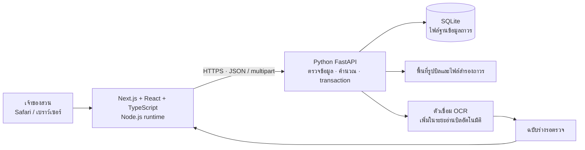
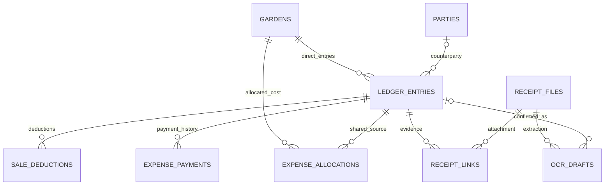

# สเปกและแผนพัฒนาเว็บรายรับรายจ่ายสวนปาล์ม

Status: draft — ยืนยันแนวทางทดสอบแล้ว รอตั้งค่า issue tracker ก่อนเผยแพร่พร้อมป้าย ready-for-agent

วันที่: 19 ตุลาคม 2569 · เขตเวลา Asia/Bangkok

เอกสารนี้สังเคราะห์จากข้อสรุปกับเจ้าของสวน ต้นแบบแบบแรก และ user flow ที่จัดทำไว้ เป็นแผนพัฒนา ไม่ใช่รายงานว่าระบบ production ถูกสร้างแล้ว

## Problem Statement

เจ้าของสวนดูแลหลายสวนด้วยตนเอง ต้องรวบรวมบิลขาย ค่าแรง ปุ๋ย และค่าบำรุงรักษา ซึ่งเกิดและจ่ายเงินคนละวันกัน ค่าแรงมีทั้งรายวันและตามผลผลิต และอาจทยอยจ่ายตามความสะดวก จึงต้องรู้ว่าสวนแต่ละแห่งมีรายรับ รายจ่าย ยอดสุทธิ และหนี้ค้างเท่าไร โดยไม่หักรายจ่ายซ้ำเมื่อจ่ายหนี้

การบันทึกต้องง่ายบน Safari และทำย้อนหลังได้ ไม่ต้องติดตั้งแอพ iOS หน้าจอควรมีข้อมูลเท่าที่จำเป็น พร้อม motion ที่ช่วยให้เข้าใจสิ่งที่เปลี่ยน ไม่รบกวนงานบันทึกตัวเลข

ฐานปัจจุบันมีต้นแบบ HTML ที่บันทึกข้อมูลเฉพาะเบราว์เซอร์ พร้อมแบบทดสอบกติกาบางส่วน ยังไม่มี Python API, ฐานข้อมูล SQL ส่วนกลาง, การอ่านบิลอัตโนมัติ หรือการตรวจการใช้งาน Safari จริง

## Solution

สร้างเว็บสำหรับเจ้าของสวนคนเดียว โดยรักษาโทนเขียวและพื้นเรียบจากแบบแรก ใช้ 4 หน้าหลัก: ภาพรวม, รายการ, สวน และรายละเอียดสวน ฟอร์มและรายละเอียดรายการเปิดเป็นป๊อปอัปหรือแผงเลื่อนบนมือถือ

- **Frontend:** Next.js App Router + React + TypeScript ทำงานด้วย Node.js รุ่น LTS ที่รองรับร่วมกัน ณ วันเริ่มพัฒนา
- **Backend:** Python + FastAPI + Pydantic โดยให้ backend เป็นผู้ตรวจสอบและคำนวณยอดทั้งหมด
- **Database:** SQLite เป็นไฟล์ฐานข้อมูลเดียว พร้อม SQL schema และ migration ที่มีเวอร์ชัน
- **Motion:** ใช้ CSS transitions สำหรับปุ่ม/ช่องกรอก และ Motion for React เฉพาะแผงฟอร์ม การเปลี่ยนหน้า และสถานะบันทึกสำเร็จ
- **บิล:** แนบรูปและกรอกเองได้ตั้งแต่รุ่นแรก จากนั้นเพิ่มการอ่านบิลอัตโนมัติแบบต้องตรวจยืนยันก่อนบันทึก

คำว่า “SQL file” ในแผนนี้แยกเป็นสองสิ่ง: ไฟล์ `.sql` คือคำสั่งสร้าง/อัปเกรดโครงสร้าง ส่วนไฟล์ SQLite `.db` เก็บข้อมูลใช้งานจริง รูปบิลเก็บในพื้นที่ไฟล์ถาวรและอ้างอิงจากฐานข้อมูล

## User Stories

1. As an เจ้าของสวน, I want เปิดเว็บผ่าน Safari, so that ใช้งานได้โดยไม่ต้องติดตั้งแอพ iOS
2. As an เจ้าของสวน, I want มีบัญชีเจ้าของเพียงคนเดียว, so that ไม่ต้องจัดการสิทธิ์ของคนงานหลายบัญชี
3. As an เจ้าของสวน, I want เริ่มจากหน้าจอเรียบง่ายตามแบบแรก, so that เข้าใจยอดและเริ่มบันทึกได้ทันที
4. As an เจ้าของสวน, I want เพิ่มสวนหลายแห่ง, so that แยกรายรับรายจ่ายตามสวนจริง
5. As an เจ้าของสวน, I want แก้ชื่อสวนและเก็บสวนที่เลิกใช้เป็นประวัติ, so that ข้อมูลเก่าไม่หาย
6. As an เจ้าของสวน, I want ตั้งยอดสุทธิยกมาแยกสวน, so that เริ่มใช้ได้โดยไม่ต้องลงย้อนหลังทั้งหมด
7. As an เจ้าของสวน, I want ลงหนี้ค้างเดิมแยกสวนและเจ้าหนี้, so that ติดตามการจ่ายต่อได้โดยไม่หักรายจ่ายเก่าซ้ำ
8. As an เจ้าของสวน, I want เห็นยอดสุทธิของแต่ละสวนก่อนรวมทุกสวน, so that เปรียบเทียบผลของแต่ละสวนได้
9. As an เจ้าของสวน, I want เห็นค่าใช้จ่ายส่วนกลางแยกไว้, so that ยอดรวมไม่ตกหล่นก่อนแบ่งเข้าสวน
10. As an เจ้าของสวน, I want ถ่ายหรือเลือกรูปบิลขาย, so that ลดการจดข้อมูลจากกระดาษ
11. As an เจ้าของสวน, I want เปิดดูรูปต้นฉบับจากรายการ, so that ตรวจสอบย้อนหลังได้
12. As an เจ้าของสวน, I want เลือกสวน วันที่ ผู้รับซื้อ และเลขบิล, so that รู้แหล่งที่มาของรายรับ
13. As an เจ้าของสวน, I want กรอกน้ำหนักสุทธิ ราคาต่อกิโลกรัม และรายการหัก, so that คำนวณยอดรับสุทธิได้ถูกต้อง
14. As an เจ้าของสวน, I want บันทึกยอดหักพร้อมคำอธิบาย, so that ตรวจยอดสุทธิในบิลได้
15. As an เจ้าของสวน, I want บันทึกการขายเมื่อรับเงินเต็มจำนวนแล้วเท่านั้น, so that ไม่ต้องจัดการลูกหนี้จากยอดขายในรุ่นนี้
16. As an เจ้าของสวน, I want รับคำเตือนเมื่อบิลอาจซ้ำ, so that ลดการบันทึกรายรับซ้ำ
17. As an เจ้าของสวน, I want ระบบอ่านข้อมูลจากรูปบิลเป็นฉบับร่าง, so that ลดการกรอกข้อมูลด้วยมือ
18. As an เจ้าของสวน, I want เห็นช่องที่อ่านไม่ชัดและตรวจแก้ก่อนยืนยัน, so that ยอดผิดไม่ถูกลงบัญชีอัตโนมัติ
19. As an เจ้าของสวน, I want กรอกเองได้เมื่ออ่านบิลไม่สำเร็จ, so that ทำงานต่อได้
20. As an เจ้าของสวน, I want เสนอค่าแรงทีมจากน้ำหนักบิล, so that ไม่ต้องกรอกผลผลิตซ้ำ
21. As an เจ้าของสวน, I want ตรวจและแก้ฐานน้ำหนักสำหรับค่าแรง, so that รองรับกรณีน้ำหนักคิดค่าจ้างต่างจากน้ำหนักขาย
22. As an เจ้าของสวน, I want กำหนดค่าแรงต่อตันของแต่ละทีม, so that คำนวณค่าจ้างรวมทีมตามข้อตกลง
23. As an เจ้าของสวน, I want บันทึกค่าแรงรายวันแยกคน, so that สะสมค่าจ้างแต่ละคนได้
24. As an เจ้าของสวน, I want บันทึกครึ่งวันและจำอัตรารายวันของคนงาน, so that ลดงานกรอกซ้ำ
25. As an เจ้าของสวน, I want แก้อัตราเฉพาะรายการได้, so that รองรับข้อตกลงที่ต่างกันแต่ละวัน
26. As an เจ้าของสวน, I want ลงค่าปุ๋ยตามจำนวนกระสอบที่ใช้ในแต่ละสวน, so that ต้นทุนเข้าสวนที่ใช้จริง
27. As an เจ้าของสวน, I want ยังไม่ลงปุ๋ยที่ไม่ได้ใช้, so that ตรงกับวิธีรับรู้รายจ่ายที่เลือก
28. As an เจ้าของสวน, I want ลงค่าวัตถุดิบ บำรุงรักษา และรายจ่ายอื่นพร้อมรูป/หมายเหตุ, so that เก็บค่าใช้จ่ายสวนได้ครบ
29. As an เจ้าของสวน, I want เลือกจ่ายครบ ยังไม่จ่าย หรือจ่ายบางส่วน, so that บันทึกสถานการณ์จริงได้
30. As an เจ้าของสวน, I want เห็นยอดค้างรายรายการ คน ทีม และร้าน, so that รู้ว่าต้องจ่ายให้ใคร
31. As an เจ้าของสวน, I want จ่ายหนี้เมื่อสะดวกโดยไม่บังคับรอบรายเดือน, so that ใช้กับรอบประมาณ 20 วันหรือรอบอื่นได้
32. As an เจ้าของสวน, I want มีประวัติวันที่และยอดจ่ายทุกครั้ง, so that ตรวจสอบยอดค้างได้
33. As an เจ้าของสวน, I want การจ่ายภายหลังลดเฉพาะยอดค้าง, so that รายจ่ายไม่ถูกนับซ้ำ
34. As an เจ้าของสวน, I want บันทึกค่าใช้จ่ายร่วมเป็นส่วนกลาง, so that ไม่ต้องเดาแบ่งสวนทันที
35. As an เจ้าของสวน, I want แบ่งยอดส่วนกลางเข้าสวนภายหลังโดยยอดรวมเท่าเดิม, so that ต้นทุนรายสวนถูกต้อง
36. As an เจ้าของสวน, I want เก็บประวัติการจ่ายเดิมไว้เมื่อแบ่งส่วนกลาง, so that ไม่สูญเสียหลักฐาน
37. As an เจ้าของสวน, I want กรองรายการตามสวน วันที่ และประเภท, so that ตรวจงานย้อนหลังได้
38. As an เจ้าของสวน, I want แก้ไขหรือยกเลิกรายการผิดพร้อมประวัติ, so that แก้ข้อมูลได้โดยรู้ว่าเปลี่ยนอะไร
39. As an เจ้าของสวน, I want ป้องกันการกดบันทึกซ้ำและแก้ข้อมูลจากแท็บเก่าทับข้อมูลใหม่, so that ยอดไม่คลาดเคลื่อน
40. As an เจ้าของสวน, I want ส่งออก CSV ภาษาไทย, so that เปิดตรวจในโปรแกรมตารางได้
41. As an เจ้าของสวน, I want สำรองและกู้คืนข้อมูลรวมรูปบิล, so that เปลี่ยนเครื่องหรือกู้ข้อมูลได้
42. As an เจ้าของสวน, I want นำข้อมูลจริงจากต้นแบบเดิมเข้าได้หลังตรวจสอบ, so that ไม่ต้องกรอกใหม่
43. As an เจ้าของสวน, I want เห็นสถานะกำลังทำงาน บันทึกสำเร็จ และข้อผิดพลาดชัดเจน, so that ไม่ต้องเดาว่ารายการถูกบันทึกหรือยัง
44. As an เจ้าของสวน, I want motion สั้นและเบา, so that แอพน่าใช้โดยไม่ทำให้การกรอกช้าลง
45. As an เจ้าของสวน, I want ลด motion ตามการตั้งค่าอุปกรณ์, so that ใช้งานสบายตา
46. As an เจ้าของสวน, I want รายการที่บันทึกแล้วเปิดจากอุปกรณ์อื่นได้ผ่านเซิร์ฟเวอร์เดียวกัน, so that ไม่ผูกกับ localStorage ของเครื่องเดียว

## Implementation Decisions

### 1. คำศัพท์และกติกาธุรกิจ

| คำ | ความหมายที่ใช้ในระบบ |
|---|---|
| สวน | หน่วยแยกรายรับและต้นทุน รองรับหลายสวน |
| ยอดสุทธิ | ยอดสุทธิยกมา + รายรับ − รายจ่ายที่เกิดขึ้นของสวน |
| ยอดสุทธิรวม | ผลรวมยอดสุทธิทุกสวน หักค่าใช้จ่ายส่วนกลางที่ยังไม่แบ่ง |
| ค้างจ่าย | ยอดเต็มของรายจ่ายหรือหนี้เดิม − ผลรวมการจ่ายที่ยังมีผล |
| ส่วนกลาง | ค่าใช้จ่ายร่วมที่ยังไม่กำหนดสวน หรืออยู่ระหว่างแบ่งเข้าสวน |
| ค่าแรงทีม | ค่าจ้างรวมทีมตามน้ำหนัก ไม่แบ่งให้สมาชิกในเฟสนี้ |
| การใช้ปุ๋ย | เหตุการณ์ที่รับรู้รายจ่ายตามกระสอบที่ใช้จริงในสวน |
| หนี้ค้างเดิม | หนี้ก่อนเริ่มใช้ ติดตามยอดจ่าย แต่ไม่ลงรายจ่ายในงวดใหม่ซ้ำ |

- ยอดสุทธิไม่ใช่ยอดเงินสดหรือยอดธนาคารที่กระทบยอดแล้ว ไม่มีบัญชีเงินสด/ธนาคารแยก ไม่มีเงินส่วนตัวหรือเงินกันสำรอง
- รายรับขายรับเต็มจำนวนเท่านั้น ไม่สร้างลูกหนี้หรือการทยอยรับเงิน
- ปุ๋ยใช้ 4 กระสอบ × 800 บาท รับรู้รายจ่าย 3,200 บาท ส่วนที่ยังไม่ใช้ไม่มีรายการ แม้ซื้อไว้นอกระบบแล้ว
- ค่าแรงรายวันรองรับจำนวนวันเป็นขั้น 0.5 ค่าแรงตามผลผลิตใช้กิโลกรัมและอัตราบาทต่อตัน
- วันทำรายการใช้วันที่ Asia/Bangkok เก็บวันที่ธุรกิจเป็น ISO date แสดงผลภาษาไทย พ.ศ. เวลา audit เก็บ UTC
- ไม่มีการปิดยอดรายเดือนอัตโนมัติ หนี้และยอดสุทธิยกต่อเนื่อง ตัวกรองวันที่แสดงความเคลื่อนไหวในช่วงนั้นโดยไม่บวกยอดยกมาซ้ำ
- การกรองวันที่รายจ่ายอิงวันเกิดรายการ ส่วนยอดค้างเป็นยอดปัจจุบันของรายการที่เข้าเงื่อนไข ไม่อ้างว่าเป็นยอดหนี้ย้อนหลัง ณ วันสิ้นงวด

### 2. สถาปัตยกรรมและการแบ่งหน้าที่

- Node.js ใช้สำหรับ frontend build/runtime ไม่สร้าง backend ธุรกิจซ้ำกับ Python
- Frontend รับผลสรุปจาก API และคำนวณ preview ได้เพื่อความลื่นไหล แต่ backend คำนวณยืนยันใหม่ก่อนเขียนทุกครั้ง
- ใช้ SQLAlchemy 2 และ Alembic สำหรับการเชื่อมข้อมูลและ migration พร้อม SQL schema ที่สร้างฐานใหม่และตรวจสอบได้ตรงกับ migration
- เริ่มจาก backend หนึ่ง instance บนเครื่องที่มี persistent local disk ใช้ SQLite WAL, foreign keys และ busy timeout ทุก connection หลีกเลี่ยง shared network filesystem
- หาก deploy บริการแบบ ephemeral ต้องมี persistent volume สำหรับฐานและรูป ห้ามเก็บข้อมูลใช้งานจริงใน filesystem ชั่วคราว
- หากต้องขยายเป็น backend หลายเครื่องภายหลัง ค่อยวางแผนย้ายฐานข้อมูล ไม่เพิ่มความซับซ้อนนี้ในรุ่นแรก
- รูปบิลอยู่นอกฐานข้อมูล เก็บ opaque storage key, MIME, ขนาด และ checksum ใน SQL เก็บเฉพาะไฟล์ที่ตรวจชนิด/ขนาดแล้ว และให้ API เจ้าของเป็นผู้เปิดอ่าน
- รองรับ JPEG, PNG, WebP และรูป HEIC/HEIF จาก iPhone ขนาดไม่เกิน 10 MB ต่อรูป โดยเก็บต้นฉบับและแปลงสำเนาสำหรับ preview/OCR ฝั่ง Python เมื่อจำเป็น ไม่เปลี่ยนต้นฉบับเป็นภาพบีบอัดทับ
- เมื่อเปิดใช้ผ่านอินเทอร์เน็ต ให้มี owner session เพียงคนเดียว ผ่าน secure HTTP-only cookie หรือ private-access gateway; ไม่มีสมัครสมาชิกหรือหลายบทบาท และไม่ฝังรหัสลับใน frontend

### 3. โมดูลที่พัฒนา

| โมดูล | ความรับผิดชอบ |
|---|---|
| Gardens | เพิ่ม/แก้ไข/เก็บประวัติสวนและยอดยกมา |
| Parties | คนงาน ทีม ผู้รับซื้อ ร้านค้า และอัตราที่จำไว้ ไม่ใช่บัญชีล็อกอิน |
| Ledger | บิลขาย รายจ่าย หนี้เดิม การแก้ไขและยกเลิก |
| Payments | การจ่ายหลายครั้งต่อรายจ่ายและการคำนวณค้าง |
| Allocations | แบ่งค่าใช้จ่ายร่วมเข้าสวนโดยไม่สร้างต้นทุนซ้ำ |
| Receipts | อัปโหลด เปิดรูป ตรวจบิลซ้ำ และ OCR ฉบับร่าง |
| Reports | ยอดแยกสวน ยอดรวม ตัวกรอง และ CSV |
| Backup | สำรอง/ตรวจ/คืนข้อมูลและย้ายข้อมูลต้นแบบ |
| Owner access | จำกัดการเข้าถึงเจ้าของเมื่อเปิดออนไลน์ |

### 4. แบบฐานข้อมูล

แบบ SQL ที่แนบเป็นโครงสร้างเริ่มต้นที่เสนอ ไม่ใช่ฐานข้อมูล production ที่ติดตั้งแล้ว

| ตาราง | ข้อมูลหลัก |
|---|---|
| gardens | ชื่อสวน ยอดสุทธิยกมา สถานะเก็บประวัติ เวอร์ชัน |
| parties | ประเภทคน/ทีม/ร้าน/ผู้ซื้อ ชื่อ อัตรารายวันที่จำ และอัตราต่อตัน |
| ledger_entries | ประเภทรายรับ/รายจ่าย/หนี้เดิม สวนหรือส่วนกลาง วันที่ หมวด ยอดเต็ม จำนวน/อัตรา หมายเหตุ บิลที่เกี่ยวข้อง เวอร์ชัน สถานะยกเลิก |
| sale_deductions | รายการหักในบิลและยอดแต่ละรายการ ใช้คำนวณยอดรับสุทธิ |
| expense_allocations | การแบ่งรายจ่ายส่วนกลางให้สวน โดยอ้างอิงรายการต้นฉบับ |
| expense_payments | วันที่และยอดจ่ายแต่ละครั้ง อ้างอิงรายจ่ายเดิม |
| receipt_files | storage key, checksum และ metadata รูปต้นฉบับ |
| receipt_links | เชื่อมรูปกับรายการ รองรับการสร้างรายรับและค่าแรงที่เกี่ยวข้อง |
| ocr_drafts | สถานะอ่านบิล ผลฉบับร่าง ช่องที่ไม่มั่นใจ และรายการที่ยืนยันแล้ว |
| audit_events | เหตุการณ์เพิ่ม/แก้/ยกเลิกและข้อมูลก่อน/หลังที่จำเป็น |
| idempotency_requests | ป้องกันคำขอบันทึกซ้ำจากการกดซ้ำหรือ retry |

- เงินเก็บเป็น integer หน่วยสตางค์ ไม่ใช้ floating point เป็นยอดเงิน authoritative
- จำนวนเก็บเป็นหน่วยย่อยคงที่: จำนวน × 1,000; เช่น 0.5 วัน = 500, 4 กระสอบ = 4,000, 3,500 กก. = 3,500,000
- อัตราเก็บเป็นสตางค์ต่อหน่วยที่ระบุ ใช้ Python Decimal/จำนวนเต็มคำนวณและปัดครึ่งขึ้นเป็นสตางค์ครั้งสุดท้าย
- ไม่เก็บยอดสุทธิหรือ paid total ซ้ำในแถวรายการ ให้คำนวณจากรายการและประวัติจ่ายที่มีผล
- ฐานข้อมูลบังคับ foreign keys, ยอดบวก, หมวด/หน่วยที่ใช้ได้, ไม่จ่ายเกินยอดเต็ม และไม่แบ่งค่าใช้จ่ายที่ไม่ใช่ส่วนกลาง
- การแบ่งส่วนกลางทั้งชุดต้องรวมเท่ากับยอดเต็ม ตรวจใน service ภายใต้ transaction เดียว ฐานข้อมูลตรวจผลรวมระหว่างเพิ่มแต่ละแถวไม่ให้เกินยอด
- รายการส่วนกลางคงอยู่เป็นรายการต้นทาง การแบ่งไม่ลบต้นทางและไม่คัดลอกประวัติจ่ายเป็นรายการจ่ายใหม่ จึงเก็บหลักฐานได้ครบและไม่มีการจ่ายซ้ำ
- ยอดจ่ายรายสวนของรายการที่แบ่งแล้วอนุมานจากสัดส่วน ใช้ cumulative rounding ตามลำดับคงที่ให้ผลรวมตรงยอดจ่ายจริง ไม่มีผลต่อยอดจ่ายรวมของเจ้าหนี้
- สวนที่มีประวัติไม่ถูก hard delete ใช้เก็บประวัติแทน รายการยกเลิกและการจ่ายที่ยกเลิกยังตรวจย้อนหลังได้

### 5. API contracts

API อยู่ภายใต้ version เดียว และใช้ error envelope ที่มี code, message และ field errors เพื่อให้ frontend ชี้ช่องผิดได้ ทุก write ตรวจข้อมูลฝั่ง Python และคืนข้อมูลที่บันทึกจริง

| กลุ่ม | วิธีและ resource | พฤติกรรม |
|---|---|---|
| สวน | GET/POST gardens; PATCH garden | อ่าน เพิ่ม แก้ชื่อ/ยอดยกมา และเก็บประวัติ |
| คนและทีม | GET/POST parties; PATCH party | จำชื่อและอัตราที่ใช้บ่อย |
| รายการ | GET entries | pagination และตัวกรองสวน หมวด ประเภท ช่วงวันที่ และค้างจ่าย |
| ขาย | POST sales | บันทึกขายรับเต็มจำนวน พร้อมยอดหักและค่าแรงทีมที่เลือก ภายใน transaction เดียว |
| รายจ่าย | POST expenses | บันทึกยอดเต็มและการจ่ายครั้งแรกถ้ามี ภายใน transaction เดียว |
| หนี้เดิม | POST opening-debts | สร้างหนี้ค้างโดยไม่เพิ่มรายจ่ายใหม่ |
| แก้ไข | GET/PATCH entry | อ่าน/แก้ไขตาม expected version ป้องกันแท็บเก่าทับข้อมูล |
| ยกเลิก | POST entry void | ยืนยันเหตุผล ตรวจผลกระทบและยกเลิกข้อมูลเกี่ยวข้องแบบ atomic เก็บ audit |
| จ่ายเงิน | POST entry payments | เพิ่มการจ่ายและตรวจยอดค้างภายใต้ write transaction ป้องกันจ่ายเกินจากคำขอพร้อมกัน |
| ส่วนกลาง | PUT entry allocations | แทนที่ชุดแบ่งทั้งหมด ตรวจผลรวมและสวนก่อน commit |
| รูปบิล | POST receipts; GET receipt | multipart upload และเปิดรูปเฉพาะเจ้าของ |
| OCR | POST receipt extraction; GET draft | สร้างงานอ่านบิลและอ่านสถานะฉบับร่าง ยังไม่สร้างรายรับ |
| ยืนยัน OCR | POST draft confirm | ตรวจแก้และยืนยันขาย ใช้ business validation เดียวกับการกรอกเอง |
| รายงาน | GET summary; GET garden summary | แยกยอดเคลื่อนไหว ยอดยกมา ยอดสุทธิ และยอดค้าง พร้อมขอบเขตช่วงวันที่ชัดเจน |
| ส่งออก | GET entries export | CSV ภาษาไทยตามตัวกรอง พร้อมป้องกัน spreadsheet formula injection |
| สำรอง | POST backup; POST restore preview/confirm | สร้าง snapshot รวมรูป ตรวจไฟล์ก่อนยืนยัน restore ทั้งชุด |

- ยอดเงินใน JSON ส่งเป็น integer หน่วยสตางค์ จำนวน/อัตรารับเป็น decimal string ที่ระบุหน่วย ห้ามฝั่ง frontend ส่งยอดคำนวณแล้วเพื่อข้ามการตรวจ
- Write operations สำคัญใช้ idempotency key: retry คำขอเดิมคืนผลเดิม key เดิมแต่ body ต่างกันคืน conflict
- HTTP 422 สำหรับ field validation; 409 สำหรับ stale version/idempotency conflict/จ่ายเกินจากข้อมูลที่เปลี่ยน; 413 สำหรับไฟล์เกินกำหนด; ไม่เปลี่ยนข้อมูลเมื่อ error
- ข้อมูลบิลซ้ำที่มี fingerprint ใกล้กันคืนคำเตือนให้ยืนยันได้ ส่วน retry ของคำขอเดียวกันไม่สร้างรายการใหม่
- แก้บิลขายไม่ปรับค่าแรงที่สร้างแล้วอย่างเงียบ ๆ ต้องแจ้งผลกระทบและให้ตรวจค่าแรงแยก การแก้รายจ่ายห้ามทำยอดเต็มต่ำกว่ายอดจ่ายที่มีผล
- การเปลี่ยนยอดของส่วนกลางที่แบ่งแล้วต้องส่งชุดแบ่งใหม่ที่ตรงกันใน transaction เดียว
- กรณียกเลิกรายจ่ายที่มีประวัติจ่าย ต้องแสดงสิ่งที่จะถูกยกเลิกและยืนยัน เก็บรายการเดิม/ประวัติเดิมใน audit ไม่มีการจำลองคืนเงินจริง

### 6. UX และ motion แบบน้อย เรียบ และใช้งานเร็ว

คงทิศทางแบบแรก: เขียวหลักประมาณ #16513E พื้นสีอุ่น #FCFBF7 ใช้ตัวอักษรไทยอ่านง่าย เช่น Noto Sans Thai เนื้อหาประมาณ 14–16 px ตัวเลขยอดสุทธิเด่น และใช้เส้นแบ่งรายการแทนกรอบการ์ดซ้อนกัน

| จุด | Motion ที่เสนอ | ระยะเวลา |
|---|---|---|
| แตะปุ่มหลัก | scale 0.98 ระหว่างกด และคืนขนาดทันที | 100–120 ms |
| เปิดฟอร์มบนมือถือ | opacity และเลื่อนขึ้นไม่เกิน 16 px | 180–220 ms |
| ปิดฟอร์ม | fade/เลื่อนกลับระยะสั้น | 140–180 ms |
| สลับหน้า | crossfade ระยะสั้น ไม่มีการบินขององค์ประกอบ | 120–160 ms |
| บันทึกสำเร็จ | toast fade พร้อมข้อความยืนยัน | 140–180 ms |
| ยอดสุทธิอัปเดต | เปลี่ยนข้อความจริงทันทีและเน้นพื้น/สีชั่วคราว | 180–250 ms |
| รายการใหม่ | fade เฉพาะแถวที่เพิ่ม ไม่เล่นทุกแถวซ้ำ | 140–180 ms |

- ค่าเวลาเป็นข้อเสนอสำหรับเริ่มพัฒนา ปรับจากการทดสอบ Safari และการใช้งานจริง
- ไม่ใช้ตัวเลขวิ่งนับ ไม่ bounce ไม่ parallax ไม่ auto-carousel ไม่ animate layout ระหว่างพิมพ์ตัวเลข
- ใช้ transform/opacity เป็นหลัก รองรับ prefers-reduced-motion โดยปิดการเคลื่อนที่และลด transition ให้สั้นหรือทันที
- ปุ่มหลักมี touch target อย่างน้อย 44 × 44 px ตัวอักษรช่องกรอกอย่างน้อย 16 px เพื่อเลี่ยง Safari zoom และใช้แป้นพิมพ์ตามชนิดข้อมูล
- ขณะบันทึก disable การกดซ้ำ แสดงสถานะ และไม่อ้างว่าบันทึกสำเร็จก่อน server ตอบ เมื่อผิดพลาดคงค่าที่กรอกไว้
- แผงฟอร์มรองรับ safe area/คีย์บอร์ด iPhone จัด focus เมื่อเปิด คืน focus เมื่อปิด เลื่อนถึงข้อผิดพลาด และประกาศผลผ่าน aria-live
- หน้าแรกมีปุ่มถ่ายบิลขายและเพิ่มรายจ่าย ไม่มีกราฟหรือ dashboard ที่เกินงานหลัก รายละเอียดซ่อนในหน้าสวนและรายการ

### 7. แผนทำงานตามลำดับ

แต่ละช่วงส่งมอบเป็น flow ที่ใช้ได้ตั้งแต่หน้าจอถึงฐานข้อมูล ไม่รอทำ backend ทั้งหมดก่อนเริ่ม UI ระยะงานด้านล่างเป็นลำดับและเกณฑ์รับงาน ไม่ใช่คำสัญญาระยะเวลา

| ช่วง | งาน | ผลที่ตรวจรับได้ | ขึ้นกับ |
|---|---|---|---|
| A — ฐานระบบและสวน | ตั้ง Node/Next และ Python/FastAPI, SQLite/migrations, owner access, เพิ่มสวน/ยอดยกมา, โครงหน้าตามแบบแรกและ motion พื้นฐาน | เพิ่ม 2 สวนผ่าน UI รีเฟรชแล้วข้อมูลยังอยู่ และ API คำนวณยอดยกมาถูกต้อง | ยืนยันแนวทดสอบและตั้งโปรเจกต์ |
| B — รายรับและรายจ่าย | รูปบิล+กรอกเอง, ขายรับเต็ม, ยอดหัก, รายจ่ายทั่วไป, ค่าแรงรายวัน/ทีม, ปุ๋ยใช้จริง, transaction/idempotency | ขาย 3,500 กก. ที่ 5 บาท หัก 500 ได้ 17,000; ค่าแรง 1,000/ตันได้ 3,500; ปุ๋ย 4 × 800 ได้ 3,200 | A |
| C — หนี้และส่วนกลาง | หนี้เดิม จ่ายบางส่วน/ครบ แบ่งส่วนกลาง ประวัติแก้ไข/ยกเลิก | จ่ายหนี้แล้วค้างลด แต่ยอดสุทธิไม่ลดซ้ำ; แบ่งส่วนกลางแล้วยอดรวมไม่เปลี่ยนและประวัติจ่ายยังอยู่ | B |
| D — รายงานและข้อมูล | ตัวกรอง รายงานแยกสวน/รวม CSV สำรอง/คืน ย้าย JSON จากต้นแบบ | ยอดทุกสวนบวกส่วนกลางตรงภาพรวม สำรองแล้วกู้คืนข้อมูลและรูปได้ | C |
| E — อ่านบิลอัตโนมัติ | เชื่อม OCR provider ผ่าน adapter, ฉบับร่าง, confidence, retry และตรวจยืนยัน | อ่านบิลเป็น draft; ไม่ลงรายรับจนยืนยัน; อ่านไม่สำเร็จยังกรอกเองได้ | B; ต้องมี provider และ credentials |
| F — ตรวจพร้อมใช้งาน | ทดสอบ iPhone/Safari จริง ตรวจภาพเทียบแบบแรก keyboard/reduced motion/slow network สาธิต restore และตั้ง deployment/backup | ตรวจ flow หลักผ่าน ไม่มี P0/P1/P2 ค้าง และไฟล์ฐาน/รูปคงอยู่หลัง restart | A–E |

จุดส่งมอบใช้งานแบบกรอกเองอยู่หลัง D ส่วนการทำงานอัตโนมัติจากรูปตามเป้าหมายครบเมื่อ E ผ่าน และต้องผ่าน F ก่อนเรียกว่า production-ready

## Testing Decisions

**แนวทางที่ผู้ใช้ยืนยันแล้ว:** ใช้จุดทดสอบหลักที่ API ของ Python เชื่อม SQLite จริงชั่วคราว เพื่อทดสอบพฤติกรรมที่ผู้ใช้มองเห็นจาก input/output และยอดสรุป ไม่ทดสอบชื่อ helper หรือการเรียก ORM ภายใน เสริม browser tests จำนวนน้อยเฉพาะ flow ที่ API พิสูจน์ไม่ได้

- **เครื่องมือ:** pytest + FastAPI HTTP client กับ SQLite file ชั่วคราวที่รัน migration จริง ไม่ใช้ mock database หรือ SQLite in-memory แทนทุกกรณี
- **ขอบเขตหลัก:** การบันทึกขาย/รายจ่าย การจ่ายหนี้ การแบ่งส่วนกลาง รายงาน และ backup/restore ผ่าน API เดียว
- **หลักเดิมที่ใช้ต่อ:** ต้นแบบมีชุดตรวจยอดแยกสวน/ยอดรวม ค่าปุ๋ยใช้จริง ค่าแรงครึ่งวัน ค่าแรงต่อตัน การจ่ายไม่หักต้นทุนซ้ำ หนี้เดิมไม่หักซ้ำ และการแบ่งส่วนกลางที่มีเศษสตางค์ นำกรณีเหล่านี้ไปตรวจผ่าน Python API ไม่ยึด JavaScript helper เดิมเป็นสัญญาของระบบ
- **หลักเดิมด้าน UI:** มีการจำลอง DOM ของ flow สำคัญ แต่ยังไม่ใช่ Safari verification ใช้เป็นรายการ flow ที่ต้องย้ายไปตรวจบนเบราว์เซอร์จริง
- **ผลคาดหวังอิสระ:** ใช้ยอดที่คำนวณจากตัวอย่างธุรกิจ ไม่เรียกฟังก์ชันเดียวกับ production เพื่อสร้าง expected result

### Acceptance scenarios

1. สวน A รายรับ 48,000 รายจ่าย 20,000 → สุทธิ 28,000; สวน B รายรับ 30,000 รายจ่าย 15,200 → สุทธิ 14,800; รวม 42,800
2. ใช้ปุ๋ยสวน A จำนวน 4 กระสอบที่ 800 → รายจ่าย 3,200 เท่านั้น ไม่มีปุ๋ยที่ยังไม่ใช้ปรากฏเป็นรายจ่าย
3. ค่าแรง 3,500 กก. ที่ 1,000 บาท/ตัน → 3,500 บาท; ค่าแรงครึ่งวันที่ 500 บาท/วัน → 250 บาท
4. หนี้ 10,000 จ่าย 6,000 → ค้าง 4,000; จ่ายเพิ่ม 4,000 → ค้าง 0; ยอดสุทธิไม่เปลี่ยนจากการจ่ายทั้งสองครั้ง
5. ยอดยกมา 5,000 พร้อมหนี้เดิม 1,000 → สุทธิยกมา 5,000 และค้าง 1,000 แยกกัน
6. ส่วนกลาง 1,000 จ่ายแล้ว 333.33 แบ่ง A 400 และ B 600 → ต้นทุนรวมยัง 1,000 และจ่ายรวมยัง 333.33 ประวัติจ่ายเดิมไม่สูญหาย
7. เศษสตางค์จากการแบ่งให้หลายสวนต้องไม่มียอดจ่ายติดลบและผลรวมตรงต้นทางทุกครั้ง
8. บันทึกขายพร้อมสร้างค่าแรงเป็น atomic: ถ้าสร้างค่าแรงไม่ผ่าน จะไม่เหลือยอดขายที่บันทึกเพียงครึ่งคำขอ
9. ส่งคำขอเดิมซ้ำด้วย idempotency key เดิม → ได้รายการเดิมหนึ่งรายการ; key เดิมแต่ body เปลี่ยน → conflict
10. คำขอจ่ายพร้อมกันสองคำขอที่รวมเกินยอดค้าง → สำเร็จได้เฉพาะยอดที่ไม่เกิน อีกคำขอได้ conflict และฐานข้อมูลไม่ผิดยอด
11. แก้จาก version เก่า → conflict และ frontend ไม่ทับข้อมูลล่าสุด
12. แก้รายจ่ายต่ำกว่ายอดที่จ่ายแล้ว หรือแบ่งส่วนกลางไม่ครบ → ปฏิเสธโดยไม่มีข้อมูลครึ่งชุด
13. ฟิลเตอร์วันที่ไม่บวกยอดยกมาซ้ำ และยอดค้างระบุว่าเป็นสถานะปัจจุบันอย่างชัดเจน
14. บิลซ้ำได้รับคำเตือน; OCR confidence ต่ำต้องตรวจ; OCR retry ไม่สร้างรายรับหรือค่าแรงซ้ำ
15. backup/restore รวมฐานและรูปได้ครบ; ไฟล์ restore เสียหรืออ้างรูปที่ขาดต้องไม่แทนข้อมูลเดิม
16. import ต้นแบบจำลอง/ข้อมูลจริงต้อง preview ก่อน และประวัติ paid เดิมที่ไม่มี payment rows ต้องถูกแปลงโดยไม่เปลี่ยนยอดค้าง
17. CSV ใช้ UTF-8 ที่อ่านภาษาไทยได้ และชื่อ/หมายเหตุที่ขึ้นต้นอักขระสูตรไม่กลายเป็นสูตรใน spreadsheet
18. เชื่อมใหม่หลัง restart แล้ว records รูปและยอดยังอยู่; migration ไม่ลบข้อมูลเดิม
19. ทดสอบผ่าน UI จริง: เริ่มสวน → ขายและแนบรูป → ลงปุ๋ย → จ่ายบางส่วน → ดูยอด → ส่งออกสำรอง
20. ทดสอบ Safari จริงที่ความกว้างประมาณ 390 px: ไม่มีปุ่มถูกคีย์บอร์ดบัง ไม่เกิด horizontal overflow; เปิด/ปิดฟอร์มและ focus ใช้ได้
21. เปิด reduced motion แล้วไม่มีการเลื่อน/นับตัวเลข; motion ปกติไม่ทำให้ input/focus กระโดด
22. ขณะ network ช้าหรือบันทึกล้มเหลว ปุ่มไม่ส่งซ้ำ ค่าที่กรอกยังอยู่ และไม่แสดงยอดสำเร็จก่อน backend ยืนยัน
23. ผู้ไม่มี owner session อ่านยอดหรือรูปไม่ได้เมื่อใช้งานออนไลน์; secrets ไม่ปรากฏใน frontend bundle/logs

## Out of Scope

- แอพ native iOS/Android และการติดตั้งจาก App Store
- หลายผู้ใช้ คนงานล็อกอิน สิทธิ์หลายบทบาท และระบบลงเวลาจากอุปกรณ์คนงาน
- คำนวณแบ่งค่าจ้างของทีมให้สมาชิกทุกคน เป็นโมดูลภายหลังตามที่ตกลง
- สต็อกปุ๋ย การซื้อปุ๋ยก่อนใช้ การตีราคาสต็อกและจัดการคลัง
- รับเงินขายบางส่วน ลูกหนี้การขาย หรือเครดิตผู้รับซื้อ
- บัญชีเงินสด/ธนาคารแยก การกระทบยอดบัญชี bank integration และรายการเงินส่วนตัว
- ระบบกันเงินสำรอง ภาษี บัญชีคู่ และรายงานกำไรทางบัญชีเต็มรูปแบบ
- Offline-first และการ sync ข้อมูลที่แก้ขณะไม่มีอินเทอร์เน็ต
- รอบจ่าย/เงินเดือนบังคับทุกเดือน การโอนเงินจริงอัตโนมัติ และการปิดงวดอัตโนมัติ
- กราฟ dashboard จำนวนมาก motion ต่อเนื่อง และลูกเล่นตกแต่งที่ไม่ช่วยงาน
- การเลือก OCR vendor โดยเดา credentials/cost; ต้องใช้ provider ที่พร้อมและได้สิทธิ์จริง
- Backend หลาย instance และระบบ queue ขนาดใหญ่ในรุ่นแรก

## Further Notes

- **ฐานที่มีแล้ว:** ต้นแบบแสดงทิศทาง UI และกติกาธุรกิจได้ แต่ไม่ได้เป็น production API หรือฐาน SQL ที่ย้ายไปใช้ตรง ๆ ได้
- **สถานะการตรวจเดิม:** สูตรและ flow แบบ DOM จำลองผ่านบางกรณี การตรวจภาพและ Safari จริงยังไม่ได้ทำ ห้ามใช้ผลเดิมแทน browser acceptance ของระบบใหม่
- **สเปกกับไฟล์ SQL:** แบบ SQL ที่แนบเป็นข้อเสนอสำหรับ bootstrap และจะต้องถูกนำไปอยู่ภายใต้ migrations ในการพัฒนา backend ไม่รันแก้ฐานใช้งานจริงเอง
- **การตรวจ SQL ครั้งนี้:** โหลด schema เข้าฐาน SQLite ชั่วคราวได้จริง ตรวจยอดแยกสวน/รวม ปุ๋ยใช้จริง การจ่ายไม่หักซ้ำ การปฏิเสธจ่ายเกิน การแบ่งส่วนกลางที่เก็บประวัติจ่ายไว้ และหนี้เดิมผ่าน พร้อม foreign-key/integrity checks ผลนี้ตรวจเฉพาะแบบฐาน ไม่ใช่ผลทดสอบ Python API ที่ยังไม่ได้พัฒนา
- **ความหมายของตัวเลข:** ชื่อยอดหลักใช้ “ยอดสุทธิ” ไม่ใช้ “เงินพร้อมใช้” เพราะปุ๋ยรับรู้เมื่อใช้และรายจ่ายอาจยังค้างจ่าย
- **การย้ายต้นแบบ:** มี preview จำนวนสวน/รายการ/ยอดก่อน import, แยกข้อมูลตัวอย่าง, ตรวจ version และ duplicate IDs และเทียบยอดก่อน/หลังก่อนยืนยัน
- **Backup จริง:** ใช้ SQLite backup API หรือ snapshot ที่รองรับ WAL ไม่คัดลอกเฉพาะไฟล์ฐานที่กำลังเขียน; manifest รวม checksum ของรูป และ restore ไปพื้นที่ใหม่เพื่อตรวจครบก่อนสลับใช้งาน
- **Issue tracker:** ไม่พบการตั้งค่า tracker ของโปรเจกต์ เอกสารนี้จึงยังเป็น draft ไม่ได้สร้าง issue หรือใช้ป้าย ready-for-agent ให้รัน `/setup-matt-pocock-skills` ก่อนเผยแพร่ตาม workflow
- **การยืนยันจากผู้ใช้:** รับแนวทดสอบ API + SQLite จริง โดยมี Safari checks เฉพาะ flow หลักแล้ว ไม่ต้องสัมภาษณ์ brief ธุรกิจซ้ำ
- **ลำดับถัดไป:** เมื่อตั้ง tracker แล้ว เผยแพร่สเปกพร้อมป้าย ready-for-agent จากนั้นค่อยแตกงานตามช่วง A–F ยังไม่เริ่ม implement ระบบ production ในงานเขียนสเปกนี้
