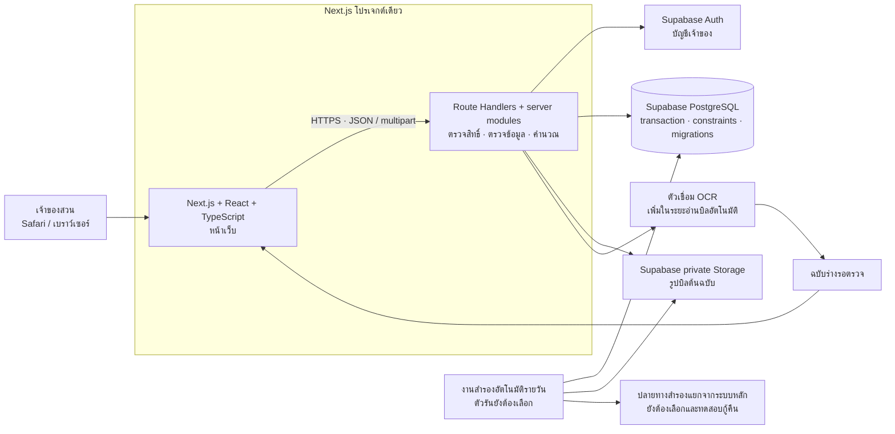
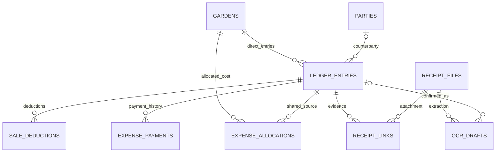

# สเปกและแผนพัฒนาเว็บรายรับรายจ่ายสวนปาล์ม

Status: draft — เริ่ม implement ขั้น 1 ในเครื่องแล้ว ยังต้องตรวจ Safari/hosted integration, โฮสต์/งานสำรอง และตั้งค่า issue tracker ก่อนเผยแพร่งานพร้อมป้าย ready-for-agent

ปรับปรุง: 20 ตุลาคม 2569 · เขตเวลา Asia/Bangkok

เอกสารนี้สังเคราะห์จากข้อสรุปกับเจ้าของสวน ต้นแบบแบบแรก และ user flow ที่จัดทำไว้ เป็นแผนพัฒนา ไม่ใช่รายงานว่าระบบ production ถูกสร้างแล้ว

## Problem Statement

เจ้าของสวนดูแลหลายสวนด้วยตนเอง ต้องรวบรวมบิลขาย ค่าแรง ปุ๋ย และค่าบำรุงรักษา ซึ่งเกิดและจ่ายเงินคนละวันกัน ค่าแรงมีทั้งรายวันและตามผลผลิต และอาจทยอยจ่ายตามความสะดวก จึงต้องรู้ว่าสวนแต่ละแห่งมีรายรับ รายจ่าย ยอดสุทธิ และหนี้ค้างเท่าไร โดยไม่หักรายจ่ายซ้ำเมื่อจ่ายหนี้

การบันทึกต้องง่ายบน Safari และทำย้อนหลังได้ ไม่ต้องติดตั้งแอพ iOS หน้าจอควรมีข้อมูลเท่าที่จำเป็น พร้อม motion ที่ช่วยให้เข้าใจสิ่งที่เปลี่ยน ไม่รบกวนงานบันทึกตัวเลข

ฐานเริ่มต้นมีต้นแบบ HTML ที่บันทึกข้อมูลเฉพาะเบราว์เซอร์พร้อมแบบทดสอบกติกาบางส่วน ปัจจุบันขั้น 1 มี Next.js API และ migrations สำหรับสวน บัญชี/session และ audit แล้ว ทดสอบกับ PostgreSQL และ Supabase Auth/REST จริงในเครื่อง ยังไม่เชื่อม hosted project ไม่มีการอ่านบิลอัตโนมัติหรือการตรวจ Safari จริง ดูสถานะในแผน 10 ขั้น

## Solution

สร้างเว็บสำหรับเจ้าของสวนคนเดียว โดยรักษาโทนเขียวและพื้นเรียบจากแบบแรก ใช้ 4 หน้าหลัก: ภาพรวม, รายการ, สวน และรายละเอียดสวน ฟอร์มและรายละเอียดรายการเปิดเป็นป๊อปอัปหรือแผงเลื่อนบนมือถือ

- **Frontend:** Next.js App Router + React + TypeScript ทำงานด้วย Node.js รุ่น LTS ที่รองรับร่วมกัน ณ วันเริ่มพัฒนา
- **Backend:** Next.js Route Handlers และโมดูล TypeScript ฝั่งเซิร์ฟเวอร์ในโปรเจกต์เดียวกับหน้าเว็บ เป็นผู้ตรวจสอบและคำนวณยอดทั้งหมด
- **Database:** Supabase PostgreSQL พร้อม SQL migrations ที่มีเวอร์ชัน ใช้ PostgreSQL ตั้งแต่พัฒนาและทดสอบ
- **บัญชีและรูปบิล:** Supabase Auth และ private Storage; ผู้ใช้เห็นช่องชื่อผู้ใช้ + รหัสผ่าน ไม่ต้องกรอกอีเมล
- **Motion:** ใช้ CSS transitions สำหรับปุ่ม/ช่องกรอก และ Motion for React เฉพาะแผงฟอร์ม การเปลี่ยนหน้า และสถานะบันทึกสำเร็จ
- **บิล:** แนบรูปและกรอกเองได้ตั้งแต่รุ่นแรก จากนั้นเพิ่มการอ่านบิลอัตโนมัติแบบต้องตรวจยืนยันก่อนบันทึก

ไฟล์ `.sql` ใช้เก็บคำสั่ง migration ส่วนข้อมูลจริงอยู่ใน PostgreSQL ของ Supabase รูปบิลอยู่ใน private Storage และอ้างอิงจากฐานข้อมูล ไฟล์ `schema.sql` ที่มีอยู่ยังเป็นข้อเสนอ SQLite จากแผนเดิม ต้องถอดกติกาเป็น PostgreSQL migrations และทดสอบใหม่ก่อนใช้

### ข้อสรุปที่ผู้ใช้ยืนยันจาก grill-me

- รวมหน้าเว็บและ API ไว้ใน Next.js โปรเจกต์เดียว ใช้ Supabase สำหรับ PostgreSQL, Auth และ Storage
- เน้นแพ็กเกจฟรีที่อนุญาตให้ใช้กับงานสวนนี้ ยอมเปลี่ยนจาก Vercel หากแพ็กเกจฟรีไม่รองรับเงื่อนไขการใช้งาน
- เจ้าของใช้ชื่อผู้ใช้ + รหัสผ่าน มีบัญชีที่เตรียมไว้ให้ ไม่มีสมัครสมาชิกทั่วไป จำการเข้าสู่ระบบ 30 วันบนเครื่องส่วนตัว
- เมื่อลืมรหัสผ่าน ให้ผู้ดูแลช่วยตั้งใหม่ ผู้ใช้ไม่ต้องผ่านขั้นตอนอีเมลกู้บัญชีเอง
- บันทึกการจ่ายผิดให้ยกเลิกเฉพาะการจ่ายเดิมแล้วบันทึกใหม่ เก็บประวัติทั้งสองครั้ง ไม่ลบรายจ่ายต้นทางและไม่จำลองคืนเงินจริง
- สำรองฐานข้อมูลและรูปอัตโนมัติทุกวันแยกจากระบบหลัก ยอมรับข้อมูลสูญหายย้อนหลังได้ประมาณหนึ่งวัน (เป้าหมาย RPO ไม่เกิน 24 ชั่วโมง)
- ยังคงตรวจรับจากพฤติกรรมผ่าน API กับฐานข้อมูลจริง เสริม Safari tests สำหรับ flow ที่ต้องพิสูจน์บนเบราว์เซอร์

## User Stories

1. As an เจ้าของสวน, I want เปิดเว็บผ่าน Safari, so that ใช้งานได้โดยไม่ต้องติดตั้งแอพ iOS
2. As an เจ้าของสวน, I want มีบัญชีเจ้าของเพียงคนเดียว, so that ไม่ต้องจัดการสิทธิ์ของคนงานหลายบัญชี
3. As an เจ้าของสวน, I want เริ่มจากหน้าจอเรียบง่ายตามแบบแรก, so that เข้าใจยอดและเริ่มบันทึกได้ทันที
4. As an เจ้าของสวน, I want เพิ่มสวนหลายแห่ง, so that แยกรายรับรายจ่ายตามสวนจริง
5. As an เจ้าของสวน, I want แก้ชื่อสวนและเก็บสวนที่เลิกใช้เป็นประวัติ, so that ข้อมูลเก่าไม่หาย
6. As an เจ้าของสวน, I want ตั้งยอดสุทธิยกมาแยกสวน, so that เริ่มใช้ได้โดยไม่ต้องลงย้อนหลังทั้งหมด
7. As an เจ้าของสวน, I want ลงหนี้ค้างเดิมแยกสวนและเจ้าหนี้, so that ติดตามการจ่ายต่อได้โดยไม่หักรายจ่ายเก่าซ้ำ
8. As an เจ้าของสวน, I want เห็นยอดสุทธิของแต่ละสวนก่อนรวมทุกสวน, so that เปรียบเทียบผลของแต่ละสวนได้
9. As an เจ้าของสวน, I want เห็นค่าใช้จ่ายส่วนกลางแยกไว้, so that ยอดรวมไม่ตกหล่นก่อนแบ่งเข้าสวน
10. As an เจ้าของสวน, I want ถ่ายหรือเลือกรูปบิลขาย, so that ลดการจดข้อมูลจากกระดาษ
11. As an เจ้าของสวน, I want เปิดดูรูปต้นฉบับจากรายการ, so that ตรวจสอบย้อนหลังได้
12. As an เจ้าของสวน, I want เลือกสวน วันที่ ผู้รับซื้อ และเลขบิล, so that รู้แหล่งที่มาของรายรับ
13. As an เจ้าของสวน, I want กรอกน้ำหนักสุทธิ ราคาต่อกิโลกรัม และรายการหัก, so that คำนวณยอดรับสุทธิได้ถูกต้อง
14. As an เจ้าของสวน, I want บันทึกยอดหักพร้อมคำอธิบาย, so that ตรวจยอดสุทธิในบิลได้
15. As an เจ้าของสวน, I want บันทึกการขายเมื่อรับเงินเต็มจำนวนแล้วเท่านั้น, so that ไม่ต้องจัดการลูกหนี้จากยอดขายในรุ่นนี้
16. As an เจ้าของสวน, I want รับคำเตือนเมื่อบิลอาจซ้ำ, so that ลดการบันทึกรายรับซ้ำ
17. As an เจ้าของสวน, I want ระบบอ่านข้อมูลจากรูปบิลเป็นฉบับร่าง, so that ลดการกรอกข้อมูลด้วยมือ
18. As an เจ้าของสวน, I want เห็นช่องที่อ่านไม่ชัดและตรวจแก้ก่อนยืนยัน, so that ยอดผิดไม่ถูกลงบัญชีอัตโนมัติ
19. As an เจ้าของสวน, I want กรอกเองได้เมื่ออ่านบิลไม่สำเร็จ, so that ทำงานต่อได้
20. As an เจ้าของสวน, I want เสนอค่าแรงทีมจากน้ำหนักบิล, so that ไม่ต้องกรอกผลผลิตซ้ำ
21. As an เจ้าของสวน, I want ตรวจและแก้ฐานน้ำหนักสำหรับค่าแรง, so that รองรับกรณีน้ำหนักคิดค่าจ้างต่างจากน้ำหนักขาย
22. As an เจ้าของสวน, I want กำหนดค่าแรงต่อตันของแต่ละทีม, so that คำนวณค่าจ้างรวมทีมตามข้อตกลง
23. As an เจ้าของสวน, I want บันทึกค่าแรงรายวันแยกคน, so that สะสมค่าจ้างแต่ละคนได้
24. As an เจ้าของสวน, I want บันทึกครึ่งวันและจำอัตรารายวันของคนงาน, so that ลดงานกรอกซ้ำ
25. As an เจ้าของสวน, I want แก้อัตราเฉพาะรายการได้, so that รองรับข้อตกลงที่ต่างกันแต่ละวัน
26. As an เจ้าของสวน, I want ลงค่าปุ๋ยตามจำนวนกระสอบที่ใช้ในแต่ละสวน, so that ต้นทุนเข้าสวนที่ใช้จริง
27. As an เจ้าของสวน, I want ยังไม่ลงปุ๋ยที่ไม่ได้ใช้, so that ตรงกับวิธีรับรู้รายจ่ายที่เลือก
28. As an เจ้าของสวน, I want ลงค่าวัตถุดิบ บำรุงรักษา และรายจ่ายอื่นพร้อมรูป/หมายเหตุ, so that เก็บค่าใช้จ่ายสวนได้ครบ
29. As an เจ้าของสวน, I want เลือกจ่ายครบ ยังไม่จ่าย หรือจ่ายบางส่วน, so that บันทึกสถานการณ์จริงได้
30. As an เจ้าของสวน, I want เห็นยอดค้างรายรายการ คน ทีม และร้าน, so that รู้ว่าต้องจ่ายให้ใคร
31. As an เจ้าของสวน, I want จ่ายหนี้เมื่อสะดวกโดยไม่บังคับรอบรายเดือน, so that ใช้กับรอบประมาณ 20 วันหรือรอบอื่นได้
32. As an เจ้าของสวน, I want มีประวัติวันที่และยอดจ่ายทุกครั้ง, so that ตรวจสอบยอดค้างได้
33. As an เจ้าของสวน, I want การจ่ายภายหลังลดเฉพาะยอดค้าง, so that รายจ่ายไม่ถูกนับซ้ำ
34. As an เจ้าของสวน, I want บันทึกค่าใช้จ่ายร่วมเป็นส่วนกลาง, so that ไม่ต้องเดาแบ่งสวนทันที
35. As an เจ้าของสวน, I want แบ่งยอดส่วนกลางเข้าสวนภายหลังโดยยอดรวมเท่าเดิม, so that ต้นทุนรายสวนถูกต้อง
36. As an เจ้าของสวน, I want เก็บประวัติการจ่ายเดิมไว้เมื่อแบ่งส่วนกลาง, so that ไม่สูญเสียหลักฐาน
37. As an เจ้าของสวน, I want กรองรายการตามสวน วันที่ และประเภท, so that ตรวจงานย้อนหลังได้
38. As an เจ้าของสวน, I want แก้ไขหรือยกเลิกรายการผิดพร้อมประวัติ, so that แก้ข้อมูลได้โดยรู้ว่าเปลี่ยนอะไร
39. As an เจ้าของสวน, I want ป้องกันการกดบันทึกซ้ำและแก้ข้อมูลจากแท็บเก่าทับข้อมูลใหม่, so that ยอดไม่คลาดเคลื่อน
40. As an เจ้าของสวน, I want ส่งออก CSV ภาษาไทย, so that เปิดตรวจในโปรแกรมตารางได้
41. As an เจ้าของสวน, I want สำรองและกู้คืนข้อมูลรวมรูปบิล, so that เปลี่ยนเครื่องหรือกู้ข้อมูลได้
42. As an เจ้าของสวน, I want นำข้อมูลจริงจากต้นแบบเดิมเข้าได้หลังตรวจสอบ, so that ไม่ต้องกรอกใหม่
43. As an เจ้าของสวน, I want เห็นสถานะกำลังทำงาน บันทึกสำเร็จ และข้อผิดพลาดชัดเจน, so that ไม่ต้องเดาว่ารายการถูกบันทึกหรือยัง
44. As an เจ้าของสวน, I want motion สั้นและเบา, so that แอพน่าใช้โดยไม่ทำให้การกรอกช้าลง
45. As an เจ้าของสวน, I want ลด motion ตามการตั้งค่าอุปกรณ์, so that ใช้งานสบายตา
46. As an เจ้าของสวน, I want รายการที่บันทึกแล้วเปิดจากอุปกรณ์อื่นได้ผ่านเซิร์ฟเวอร์เดียวกัน, so that ไม่ผูกกับ localStorage ของเครื่องเดียว
47. As an เจ้าของสวน, I want ใช้ชื่อผู้ใช้กับรหัสผ่านและจำการเข้าสู่ระบบ 30 วัน, so that ไม่ต้องพิมพ์บ่อยหรือใช้อีเมล
48. As an เจ้าของสวน, I want ให้ผู้ดูแลช่วยตั้งรหัสใหม่เมื่อลืม, so that ไม่ต้องกู้บัญชีด้วยตนเอง
49. As an เจ้าของสวน, I want ยกเลิกการจ่ายที่กรอกผิดแล้วลงใหม่โดยเก็บประวัติ, so that ยอดค้างถูกต้องโดยไม่ลบรายจ่าย
50. As an เจ้าของสวน, I want สำรองฐานและรูปอัตโนมัติทุกวันแยกจากระบบหลัก, so that กู้ข้อมูลได้ถึงจุดสำรองภายในประมาณหนึ่งวันก่อนเกิดเหตุ

## Implementation Decisions

### 1. คำศัพท์และกติกาธุรกิจ

| คำ | ความหมายที่ใช้ในระบบ |
|---|---|
| สวน | หน่วยแยกรายรับและต้นทุน รองรับหลายสวน |
| ยอดสุทธิ | ยอดสุทธิยกมา + รายรับ − รายจ่ายที่เกิดขึ้นของสวน |
| ยอดสุทธิรวม | ผลรวมยอดสุทธิทุกสวน หักค่าใช้จ่ายส่วนกลางที่ยังไม่แบ่ง |
| ค้างจ่าย | ยอดเต็มของรายจ่ายหรือหนี้เดิม − ผลรวมการจ่ายที่ยังมีผล |
| ส่วนกลาง | ค่าใช้จ่ายร่วมที่ยังไม่กำหนดสวน หรืออยู่ระหว่างแบ่งเข้าสวน |
| ค่าแรงทีม | ค่าจ้างรวมทีมตามน้ำหนัก ไม่แบ่งให้สมาชิกในเฟสนี้ |
| การใช้ปุ๋ย | เหตุการณ์ที่รับรู้รายจ่ายตามกระสอบที่ใช้จริงในสวน |
| หนี้ค้างเดิม | หนี้ก่อนเริ่มใช้ ติดตามยอดจ่าย แต่ไม่ลงรายจ่ายในงวดใหม่ซ้ำ |

- ยอดสุทธิไม่ใช่ยอดเงินสดหรือยอดธนาคารที่กระทบยอดแล้ว ไม่มีบัญชีเงินสด/ธนาคารแยก ไม่มีเงินส่วนตัวหรือเงินกันสำรอง
- รายรับขายรับเต็มจำนวนเท่านั้น ไม่สร้างลูกหนี้หรือการทยอยรับเงิน
- ปุ๋ยใช้ 4 กระสอบ × 800 บาท รับรู้รายจ่าย 3,200 บาท ส่วนที่ยังไม่ใช้ไม่มีรายการ แม้ซื้อไว้นอกระบบแล้ว
- ค่าแรงรายวันรองรับจำนวนวันเป็นขั้น 0.5 ค่าแรงตามผลผลิตใช้กิโลกรัมและอัตราบาทต่อตัน
- วันทำรายการใช้วันที่ Asia/Bangkok เก็บวันที่ธุรกิจเป็น ISO date แสดงผลภาษาไทย พ.ศ. เวลา audit เก็บ UTC
- ไม่มีการปิดยอดรายเดือนอัตโนมัติ หนี้และยอดสุทธิยกต่อเนื่อง ตัวกรองวันที่แสดงความเคลื่อนไหวในช่วงนั้นโดยไม่บวกยอดยกมาซ้ำ
- การกรองวันที่รายจ่ายอิงวันเกิดรายการ ส่วนยอดค้างเป็นยอดปัจจุบันของรายการที่เข้าเงื่อนไข ไม่อ้างว่าเป็นยอดหนี้ย้อนหลัง ณ วันสิ้นงวด

### 2. สถาปัตยกรรมและการแบ่งหน้าที่

- Next.js ทำทั้งหน้าเว็บและ API ในโปรเจกต์เดียว ใช้ runtime ฝั่งเซิร์ฟเวอร์ที่โฮสต์รองรับและทดสอบแล้ว
- Frontend รับผลสรุปจาก API และคำนวณ preview ได้เพื่อความลื่นไหล แต่ backend คำนวณยืนยันใหม่ก่อนเขียนทุกครั้ง
- เก็บ PostgreSQL migrations ใน repository ใช้สร้างฐานพัฒนา/ทดสอบใหม่ได้ และย้ายกติกา constraints จาก `schema.sql` เดิมโดยทดสอบผลลัพธ์ใหม่
- การขายพร้อมค่าแรง การจ่าย/ยกเลิกการจ่าย และการแบ่งส่วนกลางต้องจบใน PostgreSQL transaction เดียว ใช้ connection หรือ RPC ที่รองรับ transaction จริง ไม่แยกหลาย Supabase HTTP calls แล้วถือว่า atomic
- ใช้ row locking/constraints และ idempotency ป้องกันจ่ายเกินเมื่อคำขอพร้อมกัน เลือก connection/pooling ที่รองรับ runtime ของโฮสต์และทดสอบการคืน connection
- ข้อมูลและรูปอยู่ใน Supabase; filesystem ของโฮสต์ใช้เพียงงานชั่วคราวและไม่ใช่ที่เก็บข้อมูลถาวร
- รูปบิลอยู่นอกฐานข้อมูล เก็บ opaque storage key, MIME, ขนาด และ checksum ใน SQL เก็บเฉพาะไฟล์ที่ตรวจชนิด/ขนาดแล้ว เปิดอ่านหลังตรวจสิทธิ์เจ้าของผ่าน API หรือ URL อายุสั้นที่ API ออกให้
- รองรับ JPEG, PNG, WebP และรูป HEIC/HEIF จาก iPhone ขนาดไม่เกิน 10 MB ต่อรูป โดยเก็บต้นฉบับและแปลงสำเนาสำหรับ preview/OCR ฝั่งเซิร์ฟเวอร์เมื่อจำเป็น ไม่บีบอัดทับต้นฉบับ ต้องพิสูจน์ขนาด upload/การแปลงรูปกับ runtime และโควตาโฮสต์ก่อน deploy
- ทุก API ตรวจ owner session และบัญชีที่ได้รับอนุญาต ปิดสมัครสมาชิกทั่วไป ใช้ RLS/สิทธิ์ private Storage ป้องกันเข้าถึงตรงจาก client และไม่ส่ง service-role key ให้เบราว์เซอร์

#### การเข้าสู่ระบบสำหรับผู้ใช้ที่ไม่ถนัดเทคโนโลยี

- หน้าเข้าสู่ระบบมีชื่อผู้ใช้ + รหัสผ่าน ใช้ชื่อสั้นที่คุ้นเคย ไม่มีช่องอีเมลหรือขั้นตอนสมัครสมาชิก
- ผู้ดูแลเตรียมบัญชีเจ้าของใน Supabase Auth และผูกชื่อผู้ใช้กับ Auth identity ฝั่งเซิร์ฟเวอร์ หาก Auth ต้องใช้อีเมลภายใน ผู้ดูแลเป็นผู้จัดเตรียมและไม่ให้ผู้ใช้กรอก/จัดการเอง ไม่สร้างระบบเก็บรหัสผ่านซ้ำ
- ใช้ secure HTTP-only session cookies รองรับจำการเข้าสู่ระบบบนเครื่องส่วนตัว 30 วัน ผ่าน refresh flow ที่ทดสอบจริง และมีปุ่มออกจากระบบ การหมดอายุ/ตั้งรหัสใหม่ต้องกลับหน้าเข้าสู่ระบบได้ถูกต้อง
- ลืมรหัสผ่านให้แสดงวิธีติดต่อผู้ดูแล ผู้ดูแลตรวจยืนยันเจ้าของก่อนตั้งรหัสใหม่และยกเลิก session เดิม ไม่เปิด endpoint ตั้งรหัสใหม่ที่ข้ามการยืนยันตัวตน
- บัญชีผู้ดูแลใช้เพื่อดูแลระบบและกู้บัญชี ไม่เพิ่มบัญชีคนงานหรือระบบหลายบทบาทในแอพ

#### โฮสต์ฟรีและการสำรองข้อมูล

- ใช้โฮสต์ที่แพ็กเกจฟรีอนุญาตให้ใช้กับงานสวนนี้ และรองรับ Next.js API, cookies, connection ฐานข้อมูล และข้อจำกัดรูปจริง Vercel เป็นตัวเลือกเริ่มต้นที่ต้องตรวจสิทธิ์ใช้ Hobby ก่อน; ยอมเลือกโฮสต์อื่นได้
- ต้องตรวจเงื่อนไขล่าสุดของ Supabase Free: ฐานข้อมูล รูปและ bandwidth, การพักโครงการ, Auth/session, วิธีสำรอง และข้อจำกัด runtime ของโฮสต์ ไม่รับรองว่าระบบ production ทุกส่วนฟรีจนกว่าจะตรวจและทดสอบครบ
- งานสำรองทำอัตโนมัติทุกวัน เก็บข้อมูล PostgreSQL และรูปพร้อม manifest/checksum ไว้แยกจากระบบหลัก มีสถานะเวลาสำรองสำเร็จล่าสุดและแจ้งผู้ดูแลเมื่องานล้มเหลวหรือจุดสำรองเก่าเกิน 24 ชั่วโมง
- ต้องทดสอบ snapshot/export ที่สอดคล้องกันระหว่างข้อมูลกับรูป รวม migration/version และข้อมูลเชื่อมบัญชีที่จำเป็นสำหรับกู้คืน ไม่ถือว่า database dump ครอบคลุมไฟล์ใน Storage หรือการคืนบัญชี Auth โดยอัตโนมัติ
- ก่อน restore ต้องตรวจข้อมูลและรูปในพื้นที่ใหม่ เทียบยอดและ checksum แล้วสลับใช้งานตามขั้นตอนที่ทดสอบแล้ว ห้ามแทนข้อมูลเดิมด้วยชุดสำรองที่ไม่ครบ
- ยังต้องเลือกผู้ให้บริการโฮสต์ ตัวรันงานสำรอง ปลายทางสำรอง ระยะเก็บสำรอง และทดสอบกู้คืน ก่อนเรียกว่า production-ready

### 3. โมดูลที่พัฒนา

| โมดูล | ความรับผิดชอบ |
|---|---|
| Gardens | เพิ่ม/แก้ไข/เก็บประวัติสวนและยอดยกมา |
| Parties | คนงาน ทีม ผู้รับซื้อ ร้านค้า และอัตราที่จำไว้ ไม่ใช่บัญชีล็อกอิน |
| Ledger | บิลขาย รายจ่าย หนี้เดิม การแก้ไขและยกเลิก |
| Payments | การจ่ายหลายครั้ง ยกเลิกการจ่ายผิด เก็บประวัติ และคำนวณค้าง |
| Allocations | แบ่งค่าใช้จ่ายร่วมเข้าสวนโดยไม่สร้างต้นทุนซ้ำ |
| Receipts | อัปโหลด เปิดรูป ตรวจบิลซ้ำ และ OCR ฉบับร่าง |
| Reports | ยอดแยกสวน ยอดรวม ตัวกรอง และ CSV |
| Backup | สำรองฐานและรูปอัตโนมัติรายวันแยกจากระบบหลัก ตรวจ/คืนข้อมูลและย้ายข้อมูลต้นแบบ |
| Owner access | ชื่อผู้ใช้ + รหัสผ่าน จำการเข้าสู่ระบบ 30 วัน และผู้ดูแลช่วยตั้งรหัสใหม่ |

### 4. แบบฐานข้อมูล

ตารางด้านล่างเป็นแบบเชิงตรรกะสำหรับ PostgreSQL ส่วน `schema.sql` ที่แนบเป็นข้อเสนอ SQLite จากแผนเดิม ไม่ใช่ PostgreSQL migration หรือฐาน production ที่ติดตั้งแล้ว

| ตาราง | ข้อมูลหลัก |
|---|---|
| gardens | ชื่อสวน ยอดสุทธิยกมา สถานะเก็บประวัติ เวอร์ชัน |
| parties | ประเภทคน/ทีม/ร้าน/ผู้ซื้อ ชื่อ อัตรารายวันที่จำ และอัตราต่อตัน |
| ledger_entries | ประเภทรายรับ/รายจ่าย/หนี้เดิม สวนหรือส่วนกลาง วันที่ หมวด ยอดเต็ม จำนวน/อัตรา หมายเหตุ บิลที่เกี่ยวข้อง เวอร์ชัน สถานะยกเลิก |
| sale_deductions | รายการหักในบิลและยอดแต่ละรายการ ใช้คำนวณยอดรับสุทธิ |
| expense_allocations | การแบ่งรายจ่ายส่วนกลางให้สวน โดยอ้างอิงรายการต้นฉบับ |
| expense_payments | วันที่และยอดจ่ายแต่ละครั้ง อ้างอิงรายจ่ายเดิม พร้อมสถานะ/เหตุผลยกเลิกและ audit |
| receipt_files | storage key, checksum และ metadata รูปต้นฉบับ |
| receipt_links | เชื่อมรูปกับรายการ รองรับการสร้างรายรับและค่าแรงที่เกี่ยวข้อง |
| ocr_drafts | สถานะอ่านบิล ผลฉบับร่าง ช่องที่ไม่มั่นใจ และรายการที่ยืนยันแล้ว |
| audit_events | เหตุการณ์เพิ่ม/แก้/ยกเลิกและข้อมูลก่อน/หลังที่จำเป็น |
| idempotency_requests | ป้องกันคำขอบันทึกซ้ำจากการกดซ้ำหรือ retry |

- เงินเก็บเป็น integer หน่วยสตางค์ ไม่ใช้ floating point เป็นยอดเงิน authoritative
- จำนวนเก็บเป็นหน่วยย่อยคงที่: จำนวน × 1,000; เช่น 0.5 วัน = 500, 4 กระสอบ = 4,000, 3,500 กก. = 3,500,000
- อัตราเก็บเป็นสตางค์ต่อหน่วยที่ระบุ ใช้จำนวนเต็ม/decimal arithmetic ฝั่งเซิร์ฟเวอร์และ PostgreSQL คำนวณ ปัดครึ่งขึ้นเป็นสตางค์ครั้งสุดท้าย การส่ง bigint ผ่าน JSON ต้องไม่สูญเสียความแม่นยำ
- ไม่เก็บยอดสุทธิหรือ paid total ซ้ำในแถวรายการ ให้คำนวณจากรายการและประวัติจ่ายที่มีผล
- ฐานข้อมูลบังคับ foreign keys, ยอดบวก, หมวด/หน่วยที่ใช้ได้, ไม่จ่ายเกินยอดเต็ม และไม่แบ่งค่าใช้จ่ายที่ไม่ใช่ส่วนกลาง
- การแบ่งส่วนกลางทั้งชุดต้องรวมเท่ากับยอดเต็ม ตรวจใน service ภายใต้ transaction เดียว ฐานข้อมูลตรวจผลรวมระหว่างเพิ่มแต่ละแถวไม่ให้เกินยอด
- รายการส่วนกลางคงอยู่เป็นรายการต้นทาง การแบ่งไม่ลบต้นทางและไม่คัดลอกประวัติจ่ายเป็นรายการจ่ายใหม่ จึงเก็บหลักฐานได้ครบและไม่มีการจ่ายซ้ำ
- ยอดจ่ายรายสวนของรายการที่แบ่งแล้วอนุมานจากสัดส่วน ใช้ cumulative rounding ตามลำดับคงที่ให้ผลรวมตรงยอดจ่ายจริง ไม่มีผลต่อยอดจ่ายรวมของเจ้าหนี้
- สวนที่มีประวัติไม่ถูก hard delete ใช้เก็บประวัติแทน รายการยกเลิกและการจ่ายที่ยกเลิกยังตรวจย้อนหลังได้

### 5. API contracts

API อยู่ใน Next.js โปรเจกต์เดียวกับหน้าเว็บ ภายใต้ version เดียว ใช้ error envelope ที่มี code, message และ field errors เพื่อให้ frontend ชี้ช่องผิดได้ ทุก write ตรวจข้อมูลฝั่งเซิร์ฟเวอร์และคืนข้อมูลที่บันทึกจริง

| กลุ่ม | วิธีและ resource | พฤติกรรม |
|---|---|---|
| เข้าสู่ระบบ | POST session; DELETE session | รับชื่อผู้ใช้ + รหัสผ่าน สร้าง/ยกเลิก owner session; ไม่เปิดสมัครสมาชิกทั่วไป |
| สวน | GET/POST gardens; PATCH garden | อ่าน เพิ่ม แก้ชื่อ/ยอดยกมา และเก็บประวัติ |
| คนและทีม | GET/POST parties; PATCH party | จำชื่อและอัตราที่ใช้บ่อย |
| รายการ | GET entries | pagination และตัวกรองสวน หมวด ประเภท ช่วงวันที่ และค้างจ่าย |
| ขาย | POST sales | บันทึกขายรับเต็มจำนวน พร้อมยอดหักและค่าแรงทีมที่เลือก ภายใน transaction เดียว |
| รายจ่าย | POST expenses | บันทึกยอดเต็มและการจ่ายครั้งแรกถ้ามี ภายใน transaction เดียว |
| หนี้เดิม | POST opening-debts | สร้างหนี้ค้างโดยไม่เพิ่มรายจ่ายใหม่ |
| แก้ไข | GET/PATCH entry | อ่าน/แก้ไขตาม expected version ป้องกันแท็บเก่าทับข้อมูล |
| ยกเลิกรายการ | POST entry void | ยืนยันเหตุผล/ผลกระทบ เก็บ audit และยกเลิกประวัติจ่ายของรายจ่ายนั้นแบบ atomic; ค่าแรงที่ผูกบิลขายต้องตรวจแยก ไม่ยกเลิกตามเงียบ ๆ |
| จ่ายเงิน | POST entry payments | เพิ่มการจ่ายและตรวจยอดค้างภายใต้ write transaction ป้องกันจ่ายเกินจากคำขอพร้อมกัน |
| ยกเลิกการจ่าย | POST payment void | ยกเลิกเฉพาะการจ่ายที่ผิดพร้อมเหตุผล/audit คำนวณค้างใหม่ ไม่ลบรายจ่ายและไม่จำลองคืนเงินจริง |
| ส่วนกลาง | PUT entry allocations | แทนที่ชุดแบ่งทั้งหมด ตรวจผลรวมและสวนก่อน commit |
| รูปบิล | POST receipts; GET receipt | multipart upload และเปิดรูปเฉพาะเจ้าของ |
| OCR | POST receipt extraction; GET draft | สร้างงานอ่านบิลและอ่านสถานะฉบับร่าง ยังไม่สร้างรายรับ |
| ยืนยัน OCR | POST draft confirm | ตรวจแก้และยืนยันขาย ใช้ business validation เดียวกับการกรอกเอง |
| รายงาน | GET summary; GET garden summary | แยกยอดเคลื่อนไหว ยอดยกมา ยอดสุทธิ และยอดค้าง พร้อมขอบเขตช่วงวันที่ชัดเจน |
| ส่งออก | GET entries export | CSV ภาษาไทยตามตัวกรอง พร้อมป้องกัน spreadsheet formula injection |
| สำรอง | POST backup; POST restore preview/confirm | สร้าง snapshot รวมรูป ตรวจไฟล์ก่อนยืนยัน restore ทั้งชุด |

- ยอดเงินใน JSON ส่งเป็น integer หน่วยสตางค์ จำนวน/อัตรารับเป็น decimal string ที่ระบุหน่วย ห้ามฝั่ง frontend ส่งยอดคำนวณแล้วเพื่อข้ามการตรวจ
- Write operations สำคัญใช้ idempotency key: retry คำขอเดิมคืนผลเดิม key เดิมแต่ body ต่างกันคืน conflict
- HTTP 422 สำหรับ field validation; 409 สำหรับ stale version/idempotency conflict/จ่ายเกินจากข้อมูลที่เปลี่ยน; 413 สำหรับไฟล์เกินกำหนด; ไม่เปลี่ยนข้อมูลเมื่อ error
- ข้อมูลบิลซ้ำที่มี fingerprint ใกล้กันคืนคำเตือนให้ยืนยันได้ ส่วน retry ของคำขอเดียวกันไม่สร้างรายการใหม่
- แก้บิลขายไม่ปรับค่าแรงที่สร้างแล้วอย่างเงียบ ๆ ต้องแจ้งผลกระทบและให้ตรวจค่าแรงแยก การแก้รายจ่ายห้ามทำยอดเต็มต่ำกว่ายอดจ่ายที่มีผล
- การเปลี่ยนยอดของส่วนกลางที่แบ่งแล้วต้องส่งชุดแบ่งใหม่ที่ตรงกันใน transaction เดียว
- กรณียกเลิกรายจ่ายที่มีประวัติจ่าย ต้องแสดงสิ่งที่จะถูกยกเลิกและยืนยัน เก็บรายการเดิม/ประวัติเดิมใน audit ไม่มีการจำลองคืนเงินจริง
- แก้การจ่ายที่กรอกผิดด้วยการยกเลิกการจ่ายเดิม แล้วเพิ่มการจ่ายใหม่ การยกเลิกต้องเป็น idempotent และใช้ transaction/locking เดียวกับการจ่าย ยอดสุทธิและยอดเต็มรายจ่ายไม่เปลี่ยน

### 6. UX และ motion แบบน้อย เรียบ และใช้งานเร็ว

คงทิศทางแบบแรก: เขียวหลักประมาณ #16513E พื้นสีอุ่น #FCFBF7 ใช้ตัวอักษรไทยอ่านง่าย เช่น Noto Sans Thai เนื้อหาประมาณ 14–16 px ตัวเลขยอดสุทธิเด่น และใช้เส้นแบ่งรายการแทนกรอบการ์ดซ้อนกัน

| จุด | Motion ที่เสนอ | ระยะเวลา |
|---|---|---|
| แตะปุ่มหลัก | scale 0.98 ระหว่างกด และคืนขนาดทันที | 100–120 ms |
| เปิดฟอร์มบนมือถือ | opacity และเลื่อนขึ้นไม่เกิน 16 px | 180–220 ms |
| ปิดฟอร์ม | fade/เลื่อนกลับระยะสั้น | 140–180 ms |
| สลับหน้า | crossfade ระยะสั้น ไม่มีการบินขององค์ประกอบ | 120–160 ms |
| บันทึกสำเร็จ | toast fade พร้อมข้อความยืนยัน | 140–180 ms |
| ยอดสุทธิอัปเดต | เปลี่ยนข้อความจริงทันทีและเน้นพื้น/สีชั่วคราว | 180–250 ms |
| รายการใหม่ | fade เฉพาะแถวที่เพิ่ม ไม่เล่นทุกแถวซ้ำ | 140–180 ms |

- ค่าเวลาเป็นข้อเสนอสำหรับเริ่มพัฒนา ปรับจากการทดสอบ Safari และการใช้งานจริง
- ไม่ใช้ตัวเลขวิ่งนับ ไม่ bounce ไม่ parallax ไม่ auto-carousel ไม่ animate layout ระหว่างพิมพ์ตัวเลข
- ใช้ transform/opacity เป็นหลัก รองรับ prefers-reduced-motion โดยปิดการเคลื่อนที่และลด transition ให้สั้นหรือทันที
- ปุ่มหลักมี touch target อย่างน้อย 44 × 44 px ตัวอักษรช่องกรอกอย่างน้อย 16 px เพื่อเลี่ยง Safari zoom และใช้แป้นพิมพ์ตามชนิดข้อมูล
- ขณะบันทึก disable การกดซ้ำ แสดงสถานะ และไม่อ้างว่าบันทึกสำเร็จก่อน server ตอบ เมื่อผิดพลาดคงค่าที่กรอกไว้
- แผงฟอร์มรองรับ safe area/คีย์บอร์ด iPhone จัด focus เมื่อเปิด คืน focus เมื่อปิด เลื่อนถึงข้อผิดพลาด และประกาศผลผ่าน aria-live
- หน้าแรกมีปุ่มถ่ายบิลขายและเพิ่มรายจ่าย ไม่มีกราฟหรือ dashboard ที่เกินงานหลัก รายละเอียดซ่อนในหน้าสวนและรายการ

### 7. แผนทำงานตามลำดับ

ภาพรวม A–F ด้านล่างเป็นกลุ่มงานหลัก ส่วนแผนลงมือที่ผู้ใช้ขอให้รวมเหลือ 10 ขั้นพร้อมเกณฑ์ตรวจรับอยู่ใน [แผนพัฒนา Palm Ledger](plans/palm-ledger.md)

แต่ละช่วงส่งมอบเป็น flow ที่ใช้ได้ตั้งแต่หน้าจอถึงฐานข้อมูล ไม่รอทำ backend ทั้งหมดก่อนเริ่ม UI ระยะงานด้านล่างเป็นลำดับและเกณฑ์รับงาน ไม่ใช่คำสัญญาระยะเวลา

| ช่วง | งาน | ผลที่ตรวจรับได้ | ขึ้นกับ |
|---|---|---|---|
| A — ฐานระบบและสวน | ตั้ง Next.js หน้าเว็บ/API โปรเจกต์เดียว, Supabase PostgreSQL/migrations/Auth, ชื่อผู้ใช้ + รหัสผ่าน/session/การช่วยตั้งรหัสใหม่, เพิ่มสวน/ยอดยกมา, โครงหน้าตามแบบแรกและ motion พื้นฐาน | เพิ่ม 2 สวนผ่าน UI รีเฟรช/เปลี่ยนอุปกรณ์แล้วข้อมูลยังอยู่ API คำนวณยอดยกมาถูกต้อง และตรวจ session/สิทธิ์เจ้าของผ่าน | ยืนยันแนวทดสอบและตั้งโปรเจกต์ |
| B — รายรับและรายจ่าย | รูปบิล+กรอกเอง, ขายรับเต็ม, ยอดหัก, รายจ่ายทั่วไป, ค่าแรงรายวัน/ทีม, ปุ๋ยใช้จริง, transaction/idempotency | ขาย 3,500 กก. ที่ 5 บาท หัก 500 ได้ 17,000; ค่าแรง 1,000/ตันได้ 3,500; ปุ๋ย 4 × 800 ได้ 3,200 | A |
| C — หนี้และส่วนกลาง | หนี้เดิม จ่ายบางส่วน/ครบ ยกเลิกการจ่ายผิดแล้วลงใหม่ แบ่งส่วนกลาง ประวัติแก้ไข/ยกเลิก | จ่ายหนี้/ยกเลิกการจ่ายเปลี่ยนเฉพาะค้าง ไม่หักยอดสุทธิซ้ำ; แบ่งส่วนกลางแล้วยอดรวมไม่เปลี่ยนและประวัติจ่ายยังอยู่ | B |
| D — รายงานและข้อมูล | ตัวกรอง รายงานแยกสวน/รวม CSV สำรอง/คืนฐานและรูป งานสำรองรายวันแยกจากระบบหลัก ย้าย JSON จากต้นแบบ | ยอดทุกสวนบวกส่วนกลางตรงภาพรวม สำรองแล้วกู้คืนข้อมูลและรูปได้ครบ และแสดงเวลาสำรองสำเร็จล่าสุด | C; ต้องมีตัวรัน/ปลายทางสำรองที่ตรวจเงื่อนไขแล้ว |
| E — อ่านบิลอัตโนมัติ | เชื่อม OCR provider ผ่าน adapter, ฉบับร่าง, confidence, retry และตรวจยืนยัน | อ่านบิลเป็น draft; ไม่ลงรายรับจนยืนยัน; อ่านไม่สำเร็จยังกรอกเองได้ | B; ต้องมี provider และ credentials |
| F — ตรวจพร้อมใช้งาน | ทดสอบ iPhone/Safari จริง keyboard/reduced motion/slow network, username/session/reset, upload รูป, สาธิต restore และตรวจโควตา/สิทธิ์โฮสต์ฟรี/งานสำรอง | flow หลักผ่าน ไม่มี P0/P1/P2 ค้าง ฐาน/รูปยังอยู่หลัง redeploy และสำรอง/กู้คืนแยกจากระบบหลักได้ตามเป้าหมาย 24 ชั่วโมง | A–E; ต้องผ่านเงื่อนไขโฮสต์และโควตาบริการจริง |

จุดส่งมอบใช้งานแบบกรอกเองอยู่หลัง D ส่วนการทำงานอัตโนมัติจากรูปตามเป้าหมายครบเมื่อ E ผ่าน และต้องผ่าน F ก่อนเรียกว่า production-ready

## Testing Decisions

**แนวทางที่ผู้ใช้ยืนยันแล้ว:** ใช้จุดทดสอบหลักที่ Next.js API เชื่อม PostgreSQL จริงในฐานทดสอบแยกจาก production เพื่อทดสอบพฤติกรรมที่ผู้ใช้มองเห็นจาก input/output และยอดสรุป ไม่ทดสอบชื่อ helper หรือการเรียกฐานภายใน เสริม browser tests จำนวนน้อยเฉพาะ flow ที่ API พิสูจน์ไม่ได้

- **เครื่องมือ:** ใช้ Node.js/TypeScript integration runner ส่ง HTTP ไป Next.js API และรัน PostgreSQL migrations จริงในฐานทดสอบที่ล้างแยกได้ ไม่ใช้ SQLite หรือ mock database แทน PostgreSQL; การเข้าถึง Auth/Storage ใช้ Supabase local/test environment แยกจากข้อมูลจริง
- **ขอบเขตหลัก:** การบันทึกขาย/รายจ่าย การจ่ายหนี้ การแบ่งส่วนกลาง รายงาน และ backup/restore ผ่าน API เดียว
- **หลักเดิมที่ใช้ต่อ:** ต้นแบบมีชุดตรวจยอดแยกสวน/ยอดรวม ค่าปุ๋ยใช้จริง ค่าแรงครึ่งวัน ค่าแรงต่อตัน การจ่ายไม่หักต้นทุนซ้ำ หนี้เดิมไม่หักซ้ำ และการแบ่งส่วนกลางที่มีเศษสตางค์ นำกรณีเหล่านี้ไปตรวจผ่าน Next.js API ไม่ยึด JavaScript helper เดิมเป็นสัญญาของระบบ
- **หลักเดิมด้าน UI:** มีการจำลอง DOM ของ flow สำคัญ แต่ยังไม่ใช่ Safari verification ใช้เป็นรายการ flow ที่ต้องย้ายไปตรวจบนเบราว์เซอร์จริง
- **ผลคาดหวังอิสระ:** ใช้ยอดที่คำนวณจากตัวอย่างธุรกิจ ไม่เรียกฟังก์ชันเดียวกับ production เพื่อสร้าง expected result

### Acceptance scenarios

1. สวน A รายรับ 48,000 รายจ่าย 20,000 → สุทธิ 28,000; สวน B รายรับ 30,000 รายจ่าย 15,200 → สุทธิ 14,800; รวม 42,800
2. ใช้ปุ๋ยสวน A จำนวน 4 กระสอบที่ 800 → รายจ่าย 3,200 เท่านั้น ไม่มีปุ๋ยที่ยังไม่ใช้ปรากฏเป็นรายจ่าย
3. ค่าแรง 3,500 กก. ที่ 1,000 บาท/ตัน → 3,500 บาท; ค่าแรงครึ่งวันที่ 500 บาท/วัน → 250 บาท
4. หนี้ 10,000 จ่าย 6,000 → ค้าง 4,000; จ่ายเพิ่ม 4,000 → ค้าง 0; ยอดสุทธิไม่เปลี่ยนจากการจ่ายทั้งสองครั้ง
5. ยอดยกมา 5,000 พร้อมหนี้เดิม 1,000 → สุทธิยกมา 5,000 และค้าง 1,000 แยกกัน
6. ส่วนกลาง 1,000 จ่ายแล้ว 333.33 แบ่ง A 400 และ B 600 → ต้นทุนรวมยัง 1,000 และจ่ายรวมยัง 333.33 ประวัติจ่ายเดิมไม่สูญหาย
7. เศษสตางค์จากการแบ่งให้หลายสวนต้องไม่มียอดจ่ายติดลบและผลรวมตรงต้นทางทุกครั้ง
8. บันทึกขายพร้อมสร้างค่าแรงเป็น atomic: ถ้าสร้างค่าแรงไม่ผ่าน จะไม่เหลือยอดขายที่บันทึกเพียงครึ่งคำขอ
9. ส่งคำขอเดิมซ้ำด้วย idempotency key เดิม → ได้รายการเดิมหนึ่งรายการ; key เดิมแต่ body เปลี่ยน → conflict
10. คำขอจ่ายพร้อมกันสองคำขอที่รวมเกินยอดค้าง → สำเร็จได้เฉพาะยอดที่ไม่เกิน อีกคำขอได้ conflict และฐานข้อมูลไม่ผิดยอด
11. แก้จาก version เก่า → conflict และ frontend ไม่ทับข้อมูลล่าสุด
12. แก้รายจ่ายต่ำกว่ายอดที่จ่ายแล้ว หรือแบ่งส่วนกลางไม่ครบ → ปฏิเสธโดยไม่มีข้อมูลครึ่งชุด
13. ฟิลเตอร์วันที่ไม่บวกยอดยกมาซ้ำ และยอดค้างระบุว่าเป็นสถานะปัจจุบันอย่างชัดเจน
14. บิลซ้ำได้รับคำเตือน; OCR confidence ต่ำต้องตรวจ; OCR retry ไม่สร้างรายรับหรือค่าแรงซ้ำ
15. backup/restore รวมฐานและรูปได้ครบ; ไฟล์ restore เสียหรืออ้างรูปที่ขาดต้องไม่แทนข้อมูลเดิม
16. import ต้นแบบจำลอง/ข้อมูลจริงต้อง preview ก่อน และประวัติ paid เดิมที่ไม่มี payment rows ต้องถูกแปลงโดยไม่เปลี่ยนยอดค้าง
17. CSV ใช้ UTF-8 ที่อ่านภาษาไทยได้ และชื่อ/หมายเหตุที่ขึ้นต้นอักขระสูตรไม่กลายเป็นสูตรใน spreadsheet
18. เชื่อมใหม่หลัง restart แล้ว records รูปและยอดยังอยู่; migration ไม่ลบข้อมูลเดิม
19. ทดสอบผ่าน UI จริง: เริ่มสวน → ขายและแนบรูป → ลงปุ๋ย → จ่ายบางส่วน → ดูยอด → ส่งออกสำรอง
20. ทดสอบ Safari จริงที่ความกว้างประมาณ 390 px: ไม่มีปุ่มถูกคีย์บอร์ดบัง ไม่เกิด horizontal overflow; เปิด/ปิดฟอร์มและ focus ใช้ได้
21. เปิด reduced motion แล้วไม่มีการเลื่อน/นับตัวเลข; motion ปกติไม่ทำให้ input/focus กระโดด
22. ขณะ network ช้าหรือบันทึกล้มเหลว ปุ่มไม่ส่งซ้ำ ค่าที่กรอกยังอยู่ และไม่แสดงยอดสำเร็จก่อน backend ยืนยัน
23. ผู้ไม่มี owner session อ่านยอดหรือรูปไม่ได้เมื่อใช้งานออนไลน์; secrets ไม่ปรากฏใน frontend bundle/logs
24. หนี้ 10,000 บันทึกจ่ายผิด 5,000 → ค้าง 5,000; ยกเลิกการจ่ายนั้น → ค้าง 10,000; บันทึกจ่ายจริง 500 → ค้าง 9,500 ยอดสุทธิไม่เปลี่ยน ประวัติเดิมยังอยู่ และ retry ยกเลิกเดิมไม่เพิ่มค้างซ้ำ
25. เจ้าของเข้าสู่ระบบด้วยชื่อผู้ใช้ + รหัสผ่านโดยไม่กรอกอีเมล เปิดครั้งถัดไปบนเครื่องส่วนตัวได้ภายใน 30 วัน; หมดอายุ/ออกจากระบบกลับหน้าเข้าใช้ และผู้ดูแลตั้งรหัสใหม่แล้ว session เดิมใช้ไม่ได้
26. งานสำรองรายวันเก็บฐานพร้อมรูปไว้แยกจากระบบหลัก แสดงเวลาสำเร็จล่าสุด; จำลองงานล้มเหลว/สำรองเก่าเกิน 24 ชั่วโมงแล้วแจ้งผู้ดูแล และกู้คืนในสภาพแวดล้อมแยกพร้อมเทียบยอด รูป และการเข้าถึงบัญชีได้
27. คำขอเข้าถึงตรง Supabase ด้วยบัญชีที่ไม่ได้รับอนุญาต/ไม่มี session อ่านหรือเขียนข้อมูลและรูปไม่ได้; การตั้งรหัสใหม่ทำได้เฉพาะผู้ดูแลที่ยืนยันตัวตนแล้ว

## Out of Scope

- แอพ native iOS/Android และการติดตั้งจาก App Store
- หลายผู้ใช้ คนงานล็อกอิน สิทธิ์หลายบทบาท และระบบลงเวลาจากอุปกรณ์คนงาน
- คำนวณแบ่งค่าจ้างของทีมให้สมาชิกทุกคน เป็นโมดูลภายหลังตามที่ตกลง
- สต็อกปุ๋ย การซื้อปุ๋ยก่อนใช้ การตีราคาสต็อกและจัดการคลัง
- รับเงินขายบางส่วน ลูกหนี้การขาย หรือเครดิตผู้รับซื้อ
- บัญชีเงินสด/ธนาคารแยก การกระทบยอดบัญชี bank integration และรายการเงินส่วนตัว
- ระบบกันเงินสำรอง ภาษี บัญชีคู่ และรายงานกำไรทางบัญชีเต็มรูปแบบ
- Offline-first และการ sync ข้อมูลที่แก้ขณะไม่มีอินเทอร์เน็ต
- รอบจ่าย/เงินเดือนบังคับทุกเดือน การโอนเงินจริงอัตโนมัติ และการปิดงวดอัตโนมัติ
- กราฟ dashboard จำนวนมาก motion ต่อเนื่อง และลูกเล่นตกแต่งที่ไม่ช่วยงาน
- การเลือก OCR vendor โดยเดา credentials/cost; ต้องใช้ provider ที่พร้อมและได้สิทธิ์จริง
- Backend หลาย instance และระบบ queue ขนาดใหญ่ในรุ่นแรก

## Further Notes

- **ฐานที่มีแล้ว:** ต้นแบบแสดงทิศทาง UI/กติกาธุรกิจ; ระบบใหม่ขั้น 1 มีบัญชีและสวนพร้อม PostgreSQL migrations ส่วนรายการขาย/รายจ่ายและขั้นถัดไปยังไม่ implement ไม่ใช่ระบบ production ครบสเปก
- **สถานะการตรวจเดิม:** สูตรและ flow แบบ DOM จำลองผ่านบางกรณี การตรวจภาพและ Safari จริงยังไม่ได้ทำ ห้ามใช้ผลเดิมแทน browser acceptance ของระบบใหม่
- **สเปกกับไฟล์ SQL:** `schema.sql` ยังคงเป็นข้อเสนอ SQLite จากแผนเดิม ส่วนระบบใหม่มี PostgreSQL migrations เฉพาะบัญชี สวน session และ audit ในขั้น 1 แล้ว ตารางรายการทางการเงินในขั้นถัดไปยังต้องพัฒนา ไม่ได้ย้ายข้อมูลจริงจาก SQLite ในงานนี้
- **ผลตรวจแบบ SQL เดิม:** เคยโหลด schema เข้าฐาน SQLite ชั่วคราวและตรวจ business cases/foreign-key/integrity checks ได้ ผลนี้ไม่ใช้แทนการยืนยัน PostgreSQL migrations หรือ Next.js API ของระบบใหม่ ดูผลตรวจขั้น 1 แยกในเอกสารวิธีพัฒนา
- **ความหมายของตัวเลข:** ชื่อยอดหลักใช้ “ยอดสุทธิ” ไม่ใช้ “เงินพร้อมใช้” เพราะปุ๋ยรับรู้เมื่อใช้และรายจ่ายอาจยังค้างจ่าย
- **การย้ายต้นแบบ:** มี preview จำนวนสวน/รายการ/ยอดก่อน import, แยกข้อมูลตัวอย่าง, ตรวจ version และ duplicate IDs และเทียบยอดก่อน/หลังก่อนยืนยัน
- **Backup จริง:** ใช้ PostgreSQL export/snapshot ที่สอดคล้องกับชุดรูปที่สำรอง แยกเก็บนอกระบบหลักทุกวัน และทดสอบ restore ตามข้อกำหนดข้างต้น งานสำรอง/ปลายทาง/ระยะเก็บยังต้องเลือกและตรวจค่าใช้จ่าย
- **เงื่อนไขบริการ:** ในรอบ grill-me เปิดเอกสารปัจจุบันของผู้ให้บริการไม่ได้เพราะ proxy ตอบ 403 จึงยังไม่ยืนยันโควตา ค่าใช้จ่าย หรือสิทธิ์ใช้แพ็กเกจฟรี ต้องตรวจ [Vercel Hobby](https://vercel.com/docs/plans/hobby), [Supabase](https://supabase.com/pricing) และโฮสต์ทางเลือกก่อน deploy ไม่ถือว่าการยืนยันสถาปัตยกรรมคือการอนุมัติบริการเสียเงิน
- **Issue tracker:** ไม่พบการตั้งค่า tracker ของโปรเจกต์ เอกสารนี้จึงยังเป็น draft ไม่ได้สร้าง issue หรือใช้ป้าย ready-for-agent ให้รัน `/setup-matt-pocock-skills` ก่อนเผยแพร่ตาม workflow
- **การยืนยันจากผู้ใช้:** ยืนยันสรุปจาก grill-me ให้ปรับสเปกและแผนภาพแล้ว ใช้ Next.js + Supabase และแนวทดสอบ API + PostgreSQL จริง เสริม Safari checks เฉพาะ flow หลัก ไม่ต้องสัมภาษณ์ brief ธุรกิจซ้ำ
- **แผนลงมือ:** งาน 10 ขั้นพร้อมเกณฑ์ตรวจรับอยู่ใน [แผนพัฒนา Palm Ledger](plans/palm-ledger.md) เริ่มขั้น 1 แล้ว ดู [วิธีรัน/ผลตรวจ](docs/development.md) ยังไม่ได้สร้าง issues; การเผยแพร่เป็น issues/ป้าย ready-for-agent ค่อยทำหลังตั้งค่า tracker
