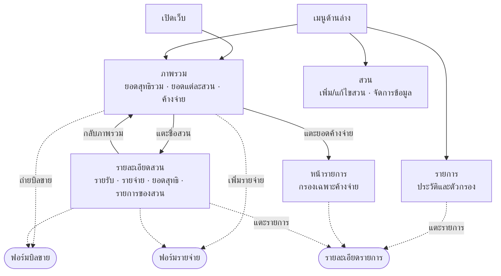
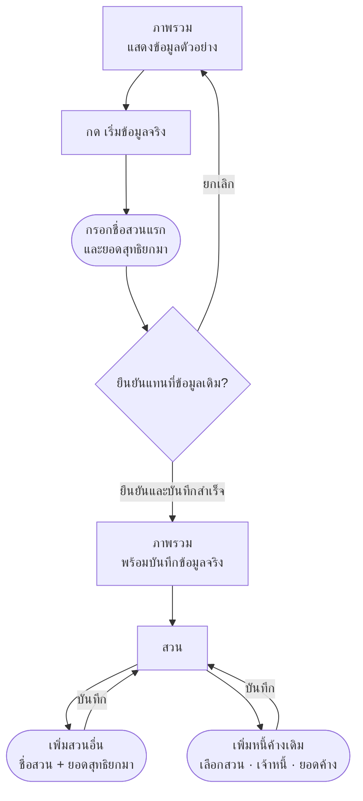
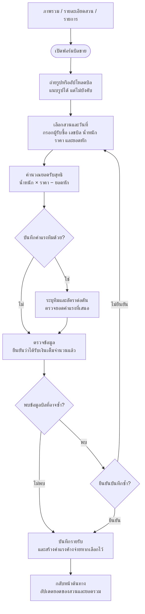
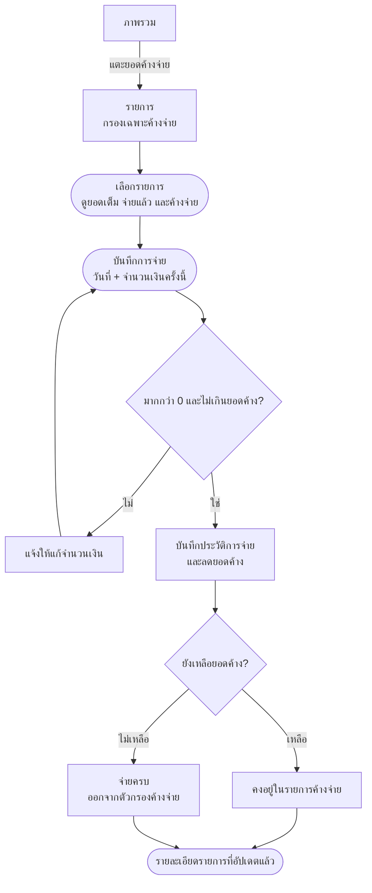
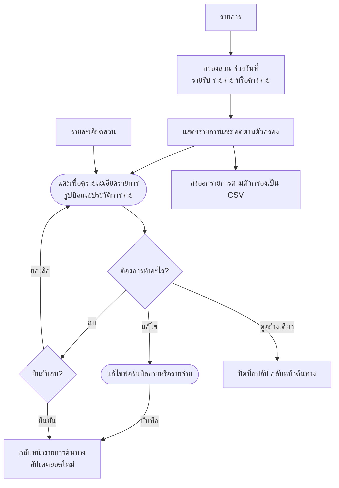
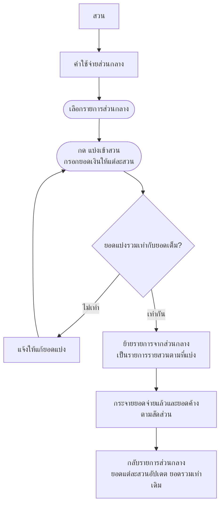
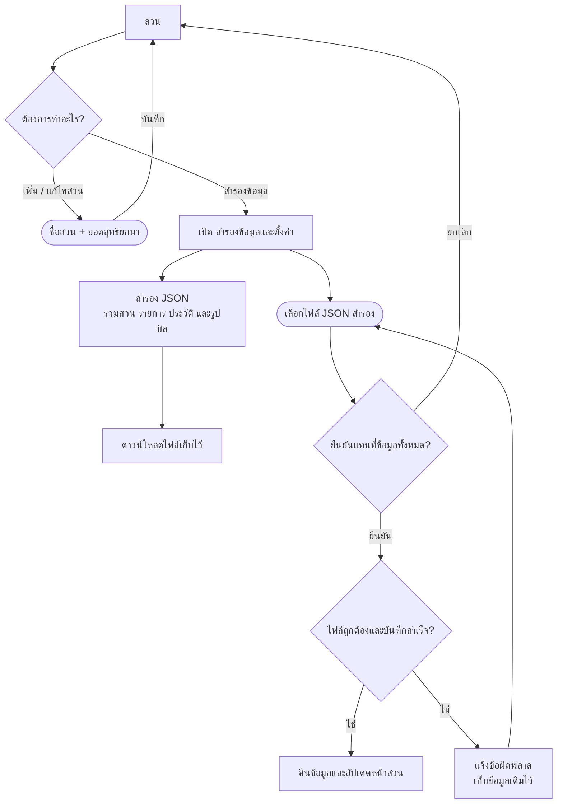
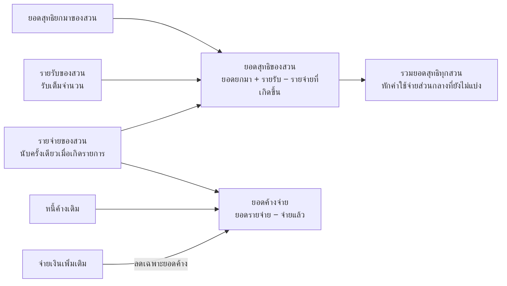

# User flow — เว็บรายรับรายจ่ายสวนปาล์ม

ผู้ใช้งาน: เจ้าของสวนคนเดียว ใช้เว็บผ่าน Safari และบันทึกย้อนหลังได้

ประกอบด้วย **4 หน้าหลัก และ 7 เส้นทางใช้งาน** หน้ากรอกข้อมูลและรายละเอียดรายการเป็นป๊อปอัป เมื่อปิดหรือบันทึกจะกลับหน้าที่เปิดมา

> แผนภาพใช้ Mermaid เปิดด้วยโปรแกรม Markdown ที่รองรับ Mermaid เพื่อดูเป็นกราฟ

## แผนผังหน้าหลัก

กรอบมุมโค้งในแผนภาพหมายถึงป๊อปอัป ไม่ใช่หน้าหลักใหม่

## 1. เริ่มใช้งานครั้งแรก

หนี้ค้างเดิมติดตามเป็นยอดที่ต้องจ่าย โดยไม่หักค่าใช้จ่ายในอดีตจากยอดสุทธิยกมาซ้ำ

## 2. บันทึกขายปาล์ม

**ขอบเขตต้นแบบปัจจุบัน:** แนบรูปและกรอกข้อมูลเอง ระบบอ่านบิลอัตโนมัติยังไม่ได้เชื่อมต่อ

**เป้าหมายเมื่อเชื่อมระบบอ่านบิล:** รูปบิล → อ่านข้อมูลอัตโนมัติ → เจ้าของตรวจแก้ → ยืนยันบันทึก โดยยังใช้กติกายอดรับเต็มจำนวนและการตรวจบิลซ้ำเหมือนเดิม

## 3. เพิ่มรายจ่าย

ค่าปุ๋ยลงรายจ่ายเฉพาะเมื่อใช้ในสวน เช่น 4 กระสอบ × 800 บาท = 3,200 บาท ไม่มีการบันทึกการซื้อหรือสต็อกในเฟสนี้

## 4. จ่ายค่าแรงหรือหนี้ค้าง

การจ่ายภายหลังไม่เพิ่มรายจ่ายซ้ำ ไม่บังคับรอบจ่าย 20 วันหรือปิดยอดสิ้นเดือน

## 5. ดูย้อนหลังและแก้ไขรายการ

การแก้ไขหรือลบบิลขายไม่แก้ไขหรือลบค่าแรงทีมที่สร้างไว้ตามบิลโดยอัตโนมัติ ต้องตรวจรายการค่าแรงแยก หากรายการมีประวัติการจ่ายแล้ว การจ่ายเพิ่มเติมให้ทำผ่าน “บันทึกการจ่าย”

## 6. แบ่งค่าใช้จ่ายส่วนกลางเข้าสวน

ค่าปุ๋ยใช้การบันทึกกระสอบที่ใส่จริงแยกแต่ละสวนตั้งแต่แรก เส้นทางแบ่งส่วนกลางใช้กับค่าใช้จ่ายร่วมอื่น เช่น ค่าซ่อมรถ

## 7. จัดการสวนและสำรองข้อมูล

ข้อมูลของต้นแบบเก็บในเบราว์เซอร์เครื่องที่ใช้ ยังไม่ซิงก์ข้ามอุปกรณ์ การล้างข้อมูลเว็บอาจทำให้ข้อมูลหาย จึงควรสำรอง JSON เป็นระยะ ส่วน CSV ใช้สำหรับอ่านรายการในโปรแกรมตาราง ไม่ใช่ไฟล์คืนข้อมูล

## กติกาการคำนวณ

ยอดสุทธิเป็นยอดตามกติกาการบันทึกของสวน ไม่ใช่การกระทบยอดเงินสดหรือบัญชีธนาคาร ตัวอย่างปุ๋ยที่ยังไม่ใช้จะยังไม่เป็นรายจ่าย แม้มีการชำระเงินซื้อล่วงหน้านอกระบบแล้ว
