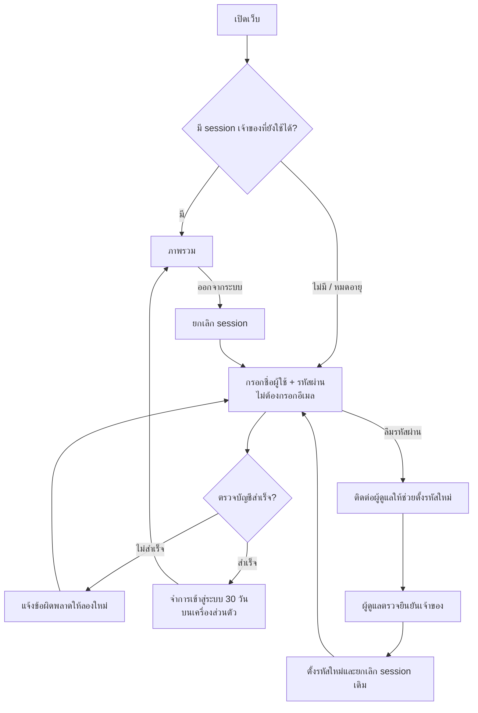
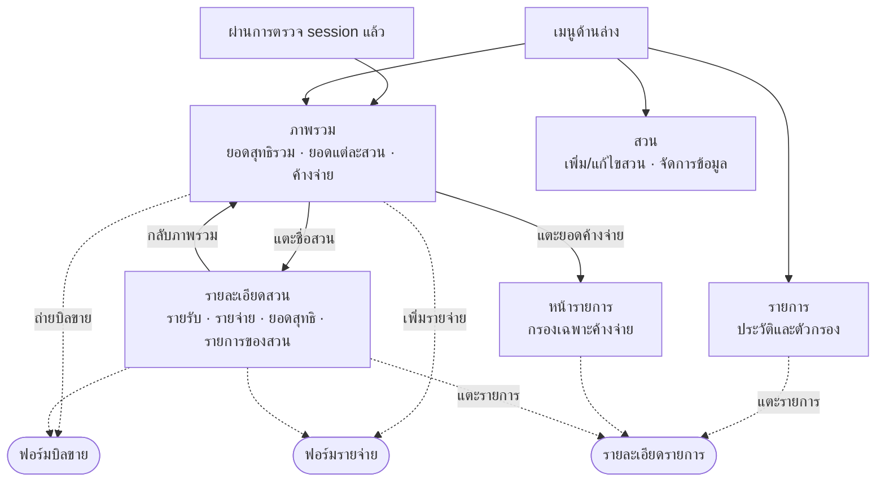
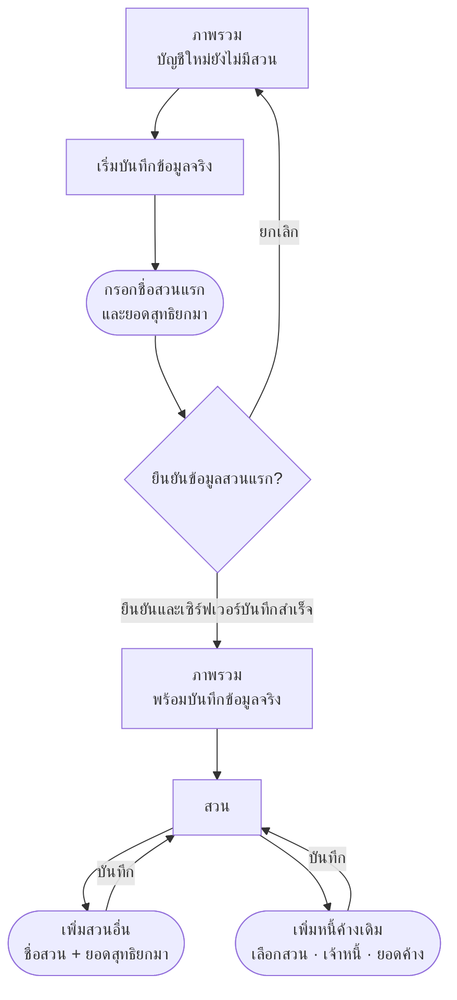
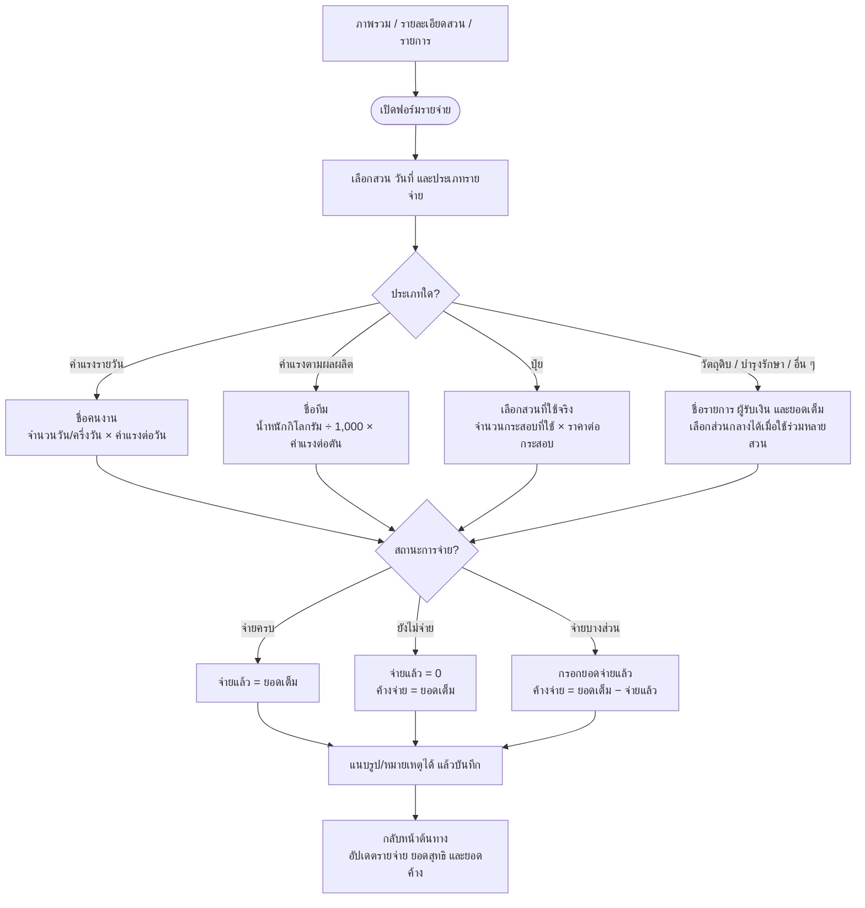
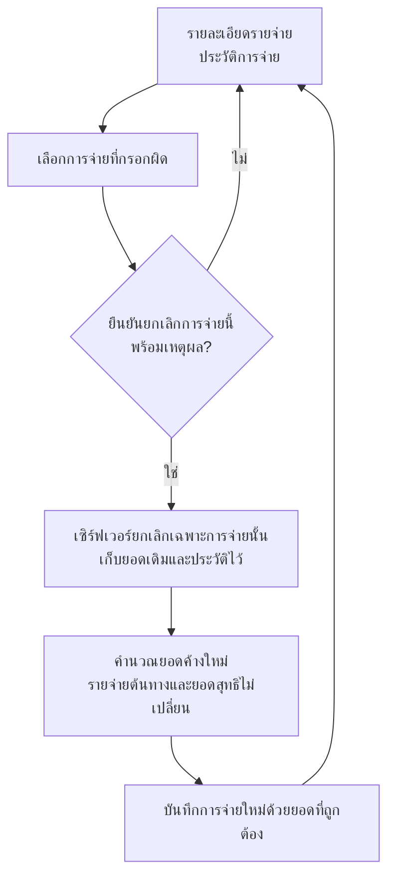
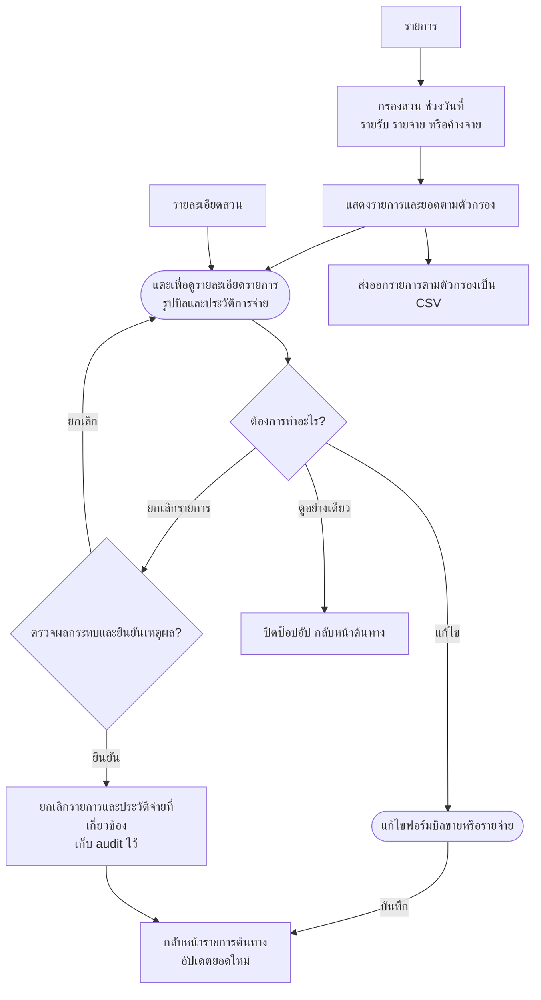
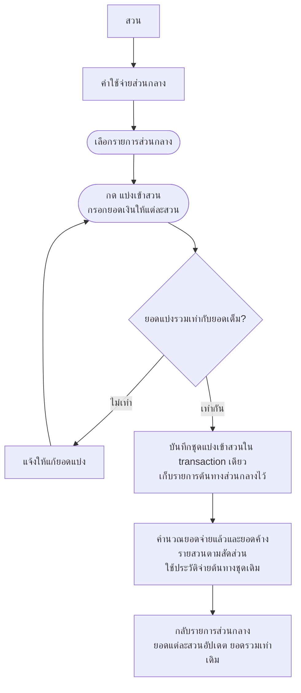
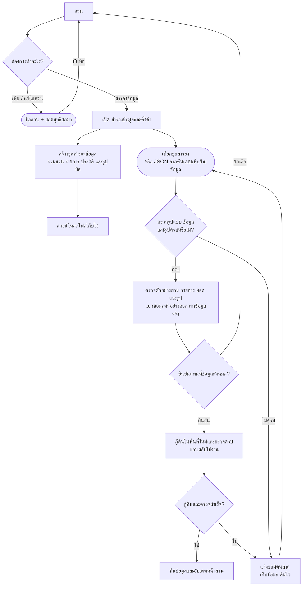
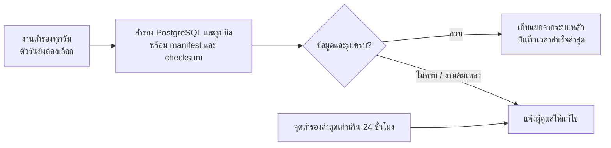
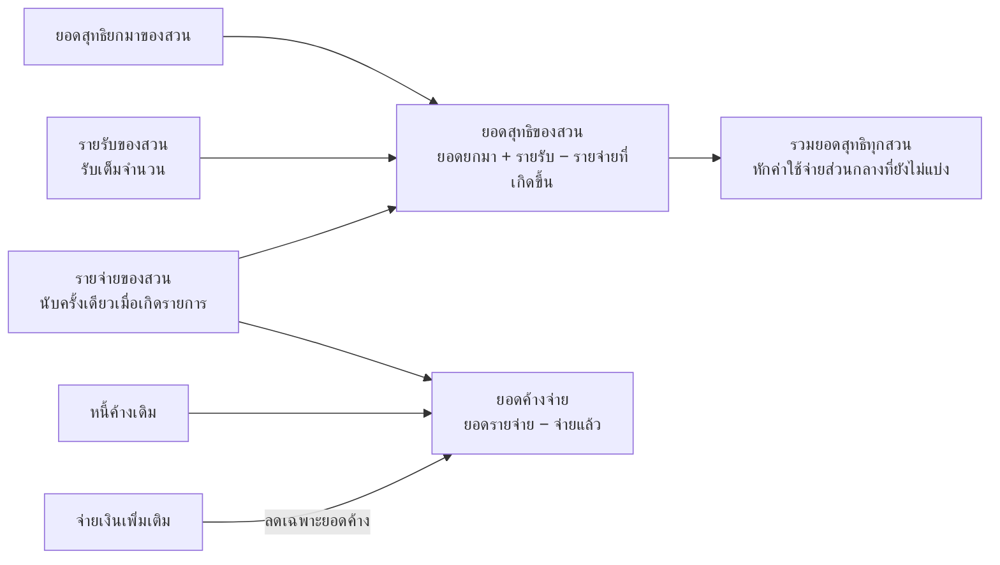

# User flow — เว็บรายรับรายจ่ายสวนปาล์ม

ผู้ใช้งาน: เจ้าของสวนคนเดียว ใช้เว็บผ่าน Safari และบันทึกย้อนหลังได้

ปรับปรุงตามข้อสรุป grill-me วันที่ 20 ตุลาคม 2569: เอกสารนี้แสดง **ระบบเป้าหมาย Next.js + Supabase** ขณะนี้ implement ขั้น 1 (บัญชีและสวน) ในเครื่องแล้ว ส่วน flow ขั้นถัดไปยังเป็นแผน ต้นแบบ HTML เดิมยังเก็บข้อมูลเฉพาะเบราว์เซอร์ ไม่มีบัญชีหรือการสำรองอัตโนมัติ ดูสถาปัตยกรรมใน [สเปก](app-spec.md) และ [สถานะการพัฒนา](plans/palm-ledger.md)

ประกอบด้วย **4 หน้าหลัก และ 7 เส้นทางงานสวน** เพิ่มขั้นตอนเข้าสู่ระบบก่อนใช้งาน หน้ากรอกข้อมูลและรายละเอียดรายการเป็นป๊อปอัป เมื่อปิดหรือบันทึกจะกลับหน้าที่เปิดมา

> แผนภาพใช้ Mermaid เปิดด้วยโปรแกรม Markdown ที่รองรับ Mermaid เพื่อดูเป็นกราฟ

## เข้าสู่ระบบและลืมรหัสผ่าน

บัญชีเจ้าของเตรียมไว้ให้ ไม่มีสมัครสมาชิกทั่วไปหรือบัญชีคนงาน การผูกชื่อผู้ใช้กับ Supabase Auth จัดการฝั่งเซิร์ฟเวอร์ ผู้ใช้ไม่ต้องจัดการอีเมลภายในของระบบ

## แผนผังหน้าหลัก

กรอบมุมโค้งในแผนภาพหมายถึงป๊อปอัป ไม่ใช่หน้าหลักใหม่

## 1. เริ่มใช้งานครั้งแรก

หนี้ค้างเดิมติดตามเป็นยอดที่ต้องจ่าย โดยไม่หักค่าใช้จ่ายในอดีตจากยอดสุทธิยกมาซ้ำ

ต้นแบบปัจจุบันเริ่มด้วยข้อมูลตัวอย่างและปุ่ม “เริ่มข้อมูลจริง” ซึ่งแทนที่ข้อมูลในเบราว์เซอร์ ส่วนระบบเป้าหมายแยกข้อมูลตัวอย่างออกจากข้อมูลจริง การย้ายข้อมูลต้นแบบต้อง preview และยืนยันตามเส้นทางสำรอง/คืนข้อมูล ไม่ล้างข้อมูลจริงเมื่อเปิดใช้จากเครื่องใหม่

## 2. บันทึกขายปาล์ม

**ขอบเขตต้นแบบปัจจุบัน:** แนบรูปและกรอกข้อมูลเอง ระบบอ่านบิลอัตโนมัติยังไม่ได้เชื่อมต่อ

**เป้าหมายเมื่อเชื่อมระบบอ่านบิล:** รูปบิล → อ่านข้อมูลอัตโนมัติ → เจ้าของตรวจแก้ → ยืนยันบันทึก โดยยังใช้กติกายอดรับเต็มจำนวนและการตรวจบิลซ้ำเหมือนเดิม

## 3. เพิ่มรายจ่าย

ค่าปุ๋ยลงรายจ่ายเฉพาะเมื่อใช้ในสวน เช่น 4 กระสอบ × 800 บาท = 3,200 บาท ไม่มีการบันทึกการซื้อหรือสต็อกในเฟสนี้

## 4. จ่ายค่าแรงหรือหนี้ค้าง

การจ่ายภายหลังไม่เพิ่มรายจ่ายซ้ำ ไม่บังคับรอบจ่าย 20 วันหรือปิดยอดสิ้นเดือน

### กรอกยอดจ่ายผิด

ตัวอย่าง: หนี้ 10,000 บาท กรอกจ่ายผิด 5,000 บาท → ค้าง 5,000 บาท; ยกเลิกครั้งนั้น → ค้าง 10,000 บาท; ลงจ่ายจริง 500 บาท → ค้าง 9,500 บาท ไม่ได้คืนเงินจริงและไม่ลบรายจ่ายต้นทาง การยกเลิกซ้ำต้องไม่เพิ่มยอดค้างซ้ำ

## 5. ดูย้อนหลังและแก้ไขรายการ

การแก้ไขหรือยกเลิกบิลขายไม่เปลี่ยนค่าแรงทีมที่สร้างไว้โดยอัตโนมัติ ต้องแสดงรายการที่เกี่ยวข้องให้ตรวจค่าแรงแยก หากรายการมีประวัติการจ่ายแล้ว การจ่ายเพิ่มทำผ่าน “บันทึกการจ่าย” และแก้ยอดจ่ายผิดตามขั้นตอนยกเลิกการจ่ายข้างต้น ห้ามแก้ยอดเต็มรายจ่ายให้ต่ำกว่ายอดจ่ายที่ยังมีผล

ระบบเป้าหมายใช้การยกเลิกพร้อม audit เพื่อเก็บประวัติ ต่างจากปุ่มลบของต้นแบบ HTML ปัจจุบัน

## 6. แบ่งค่าใช้จ่ายส่วนกลางเข้าสวน

ค่าปุ๋ยใช้การบันทึกกระสอบที่ใส่จริงแยกแต่ละสวนตั้งแต่แรก เส้นทางแบ่งส่วนกลางใช้กับค่าใช้จ่ายร่วมอื่น เช่น ค่าซ่อมรถ

ระบบเป้าหมายเก็บรายการส่วนกลางและประวัติจ่ายเดิม ไม่คัดลอกเป็นการจ่ายใหม่ ส่วนต้นแบบปัจจุบันแบ่งเป็นรายการรายสวน ทั้งสองแบบต้องรักษายอดรวมและยอดค้างให้เท่าเดิม

## 7. จัดการสวนและสำรองข้อมูล

### สำรองอัตโนมัติรายวัน

เป้าหมายระบบจริงคือสำรองอัตโนมัติทุกวันและยอมรับข้อมูลสูญหายย้อนหลังได้ประมาณ 24 ชั่วโมง ผู้ดูแลต้องทดสอบกู้คืนรวมรูป/ยอด/การเข้าถึงบัญชี ปลายทางสำรอง ตัวรัน และระยะเก็บยังต้องเลือกพร้อมตรวจข้อจำกัดแพ็กเกจฟรีก่อน deploy

ต้นแบบปัจจุบันเก็บในเบราว์เซอร์เครื่องที่ใช้ ยังไม่ซิงก์ข้ามอุปกรณ์หรือสำรองอัตโนมัติ จึงยังต้องสำรอง JSON เองเป็นระยะ ส่วน CSV ใช้สำหรับอ่านรายการในโปรแกรมตาราง ไม่ใช่ไฟล์คืนข้อมูล

## กติกาการคำนวณ

ยอดสุทธิเป็นยอดตามกติกาการบันทึกของสวน ไม่ใช่การกระทบยอดเงินสดหรือบัญชีธนาคาร ตัวอย่างปุ๋ยที่ยังไม่ใช้จะยังไม่เป็นรายจ่าย แม้มีการชำระเงินซื้อล่วงหน้านอกระบบแล้ว
